# Migrasi report Power BI antar-workspace

Script [Migrate-PowerBIReports.ps1](Migrate-PowerBIReports.ps1) memakai **Power BI REST API Clone Report** untuk report. Dengan **`-IncludeSemanticModels`**, model terkait juga diimpor dari backup PBIX ke destination dan report dihubungkan ke model baru. Sebelum Copy/Move, script mengekspor **backup PBIX lokal** melalui Export Report API. Mode **Move** menambahkan Delete Report setelah verifikasi. Kedua workspace harus sudah ada, berada dalam tenant yang sama, dan memiliki **capacityId yang sama**. Script tidak membuat workspace atau mengubah capacity.

## Disclaimer

> **Gunakan dengan risiko dan tanggung jawab Anda sendiri.** Script disediakan **apa adanya (as-is)** sebagai alat bantu otomatisasi, tanpa jaminan keberhasilan migrasi, kelengkapan backup/pemulihan, ketersediaan layanan, atau kesesuaian untuk seluruh konfigurasi Power BI/Fabric. Penggunaan API Microsoft tidak berarti proyek ini merupakan produk resmi, disertifikasi, atau didukung oleh Microsoft.

- **Ada operasi destruktif.** `-Mode Move -Apply` mengizinkan penghapusan report asal tanpa konfirmasi tambahan. Proses bukan satu transaksi, dapat selesai sebagian, dan tidak menyediakan rollback otomatis. ID/URL baru dapat memutus link, embed, app atau integrasi lama.
- **Pengguna wajib memiliki otorisasi.** Dapatkan persetujuan pemilik data/report, ikuti kebijakan organisasi, dan gunakan akun dengan izin yang sesuai. Jangan gunakan script untuk melewati kontrol akses, sensitivity labels atau pembatasan export tenant.
- **Backup bukan jaminan pemulihan.** Uji Copy dan pemulihan di lingkungan nonproduksi, validasi visual/angka/RLS sebagai pengguna tujuan, lalu ikuti [langkah aman migrasi](#langkah-aman-migrasi). Pemeriksaan hash dan status API tidak membuktikan seluruh fitur atau konfigurasi layanan telah terbawa.
- **Lindungi data lokal.** PBIX, manifest dan state dapat memuat data atau metadata sensitif. Terapkan pembatasan akses, enkripsi disk dan retensi sesuai kebijakan; jangan upload backup, token, credentials atau state ke repo publik.
- **Batas pengujian tetap berlaku.** Unit test dan tes API sample yang tercatat bukan jaminan untuk tenant produksi. Copy report + model telah diuji, tetapi Move dengan model pada sample SQL terblokir karena credentials tidak tersedia. Login interaktif modul Power BI serta validasi visual/RLS belum diverifikasi melalui tes langsung tersebut.
- **Perubahan layanan dan biaya perlu ditinjau.** API, lisensi dan batas export dapat berubah. Import/refresh memakai sumber daya capacity dan dapat memengaruhi workload lain atau biaya sesuai konfigurasi Anda.
- **Batas tanggung jawab.** Sejauh diizinkan hukum yang berlaku, penulis dan kontributor tidak bertanggung jawab atas kehilangan data, gangguan layanan, biaya atau kerugian akibat penggunaan script. Disclaimer ini tidak membatasi hak atau kewajiban yang tidak dapat dikecualikan menurut hukum, dan bukan pengganti lisensi proyek atau ketentuan layanan Microsoft.

## Ringkasan cakupan

| Komponen | Dicakup script | Batas penting |
| --- | --- | --- |
| Report biasa, halaman dan visual | Copy melalui Clone API; Move menambahkan penghapusan report asal | ID/URL baru; tampilan dan angka tetap harus diuji |
| Semantic model terkait | Opsional melalui `-IncludeSemanticModels`; satu model bersama diimpor sekali | Hanya model Import refreshable di workspace source, export IncludeModel didukung, PBIX < 1 GB |
| Referensi sumber dan parameter | Diperiksa kecocokannya pada model source/destination | Bukan penyalinan data fisik atau pembuktian credentials/koneksi aktif |
| Backup lokal | PBIX, manifest, ukuran dan SHA256 sebelum perubahan | Bukan backup seluruh workspace; uji pemulihan tetap diperlukan |
| Preview, konflik dan resume | Validasi workspace/capacity, nama, binding, state dan ID operasi | Gunakan state yang sama; tidak ada overwrite atau rollback otomatis |
| Credentials, gateway binding, refresh schedule | Tidak disalin | Konfigurasi dan uji di Power BI Service |
| Workspace access, sharing, keanggotaan RLS, app/audience, subscriptions, dashboard tiles, folder, endorsement dan labels | Tidak dimigrasikan atau diverifikasi | Tinjau manual; jangan menganggap izin pengguna ikut terbawa |
| Database, file sumber, Lakehouse, Warehouse, dataflow dan pipeline | Tidak dipindahkan | Referensi ke source/asset lama tetap menjadi dependensi |
| Direct Lake, DirectQuery/nonrefreshable dan paginated/RDL | Tidak didukung oleh jalur migrasi model/report ini | Jangan memakai opsi lain untuk melewati pembatasan |
| Model dan workspace asal | Tidak dihapus, termasuk pada Move | Menutup workspace lama memerlukan audit dependensi terpisah |

**Jalur yang disarankan:** [persiapan -> preview -> Copy + backup -> uji pengguna dan koneksi -> preview Move -> Move terkontrol](#langkah-aman-migrasi). Default tetap report-only; sertakan `-IncludeSemanticModels` jika model juga harus disalin.

## Pilihan Copy atau Move

| Mode | Report tujuan | Report asal |
| --- | --- | --- |
| `-Mode Copy` (default) | Dibuat dan diverifikasi | Tetap ada |
| `-Mode Move` | Dibuat dan diverifikasi | Dihapus setelah **semua report terpilih** lolos verifikasi API dan pemeriksaan ulang sumber |

Keduanya hanya **preview** tanpa `-Apply`. Dengan `-Apply`, semua report terpilih wajib memiliki backup lokal valid sebelum clone pertama; backup gagal berarti migrasi berhenti tanpa membuat/menghapus report. Move adalah **backup + clone + delete**, bukan perpindahan atomik yang mempertahankan ID. Jika terjadi kegagalan setelah tahap backup, sebagian salinan/penghapusan bisa sudah selesai dan dicatat di state.

**Tanpa `-IncludeSemanticModels`**, perilaku lama tetap report-only. **Dengan opsi tersebut**, report destination memakai model baru di destination. Model asal tetap ada dalam kedua mode; opsi Move hanya menghapus report asal, bukan model atau data sumbernya.

## Diagram alur aktivitas

Alur berikut mengikuti [Migrate-PowerBIReports.ps1](Migrate-PowerBIReports.ps1), termasuk penggunaan state saat proses dijalankan ulang.

```mermaid
flowchart TD
    START([Mulai]) --> INPUT["Baca workspace asal/tujuan, ReportIds, Mode dan Apply"]
    INPUT --> INIT["Siapkan StatePath<br/>Ambil lock jika Apply aktif"]
    INIT --> LOGIN["Cek modul autentikasi<br/>Login pengguna interaktif ke Power BI"]
    LOGIN --> WORKSPACES["GET daftar workspace dan resolve nama atau ID"]
    WORKSPACES --> CAPACITY{"Workspace berbeda, akses tulis,<br/>dedicated capacity dan capacityId sama?"}
    CAPACITY -->|Tidak| STOP["Berhenti dengan error<br/>Tinjau hasil dan state sebelum melanjutkan"]
    CAPACITY -->|Ya| STATE["Baca dan validasi state<br/>GET daftar report asal dan tujuan"]
    STATE --> SELECT["Pilih semua report atau ReportIds<br/>Sertakan resume Move yang sumbernya sudah hilang"]
    SELECT --> PREFLIGHT{"Jenis report, nama, binding<br/>dan state valid tanpa konflik?"}
    PREFLIGHT -->|Tidak| STOP
    PREFLIGHT -->|Ya| PLAN["Jika IncludeSemanticModels: cek model, sources, parameter dan konflik<br/>Tampilkan rencana dan batas cakupan"]
    PLAN --> APPLY{"Apply aktif?"}
    APPLY -->|Tidak| PREVIEW["Preview saja<br/>Tidak membuat atau menghapus report"]
    PREVIEW --> CLEANUP["Lepaskan lock jika diambil"]
    APPLY -->|Ya| BACKUP["Backup semua sumber yang masih ada ke PBIX lokal<br/>Sumber hilang saat resume: gunakan backup dalam state"]
    BACKUP --> BACKUPVALID{"Semua backup valid:<br/>paket PBIX, ukuran, SHA256 dan metadata?"}
    BACKUPVALID -->|Tidak| STOP
    BACKUPVALID -->|Ya| MANIFEST["Simpan backup-manifest.json dan metadata backup ke state"]
    MANIFEST --> INCLUDEMODEL{"IncludeSemanticModels aktif?"}
    INCLUDEMODEL -->|Tidak| TARGET["Proses report tujuan berikutnya"]
    INCLUDEMODEL -->|Ya| MODELBACKUP["Cek DataModel pada backup semua model<br/>Bandingkan fingerprint snapshot saat resume"]
    MODELBACKUP --> MODELIMPORT["Import sekali per model dengan skipReport<br/>Simpan importId dan poll sampai Succeeded"]
    MODELIMPORT --> MODELSOURCES{"Model tujuan dan referensi<br/>sources/parameter cocok?"}
    MODELSOURCES -->|Tidak| STOP
    MODELSOURCES -->|Ya| TARGET
    TARGET --> CLONE{"Perlu clone baru?"}
    CLONE -->|Ya| REQUEST["Simpan status CloneRequested"]
    REQUEST --> POST["POST Clone ke workspace tujuan<br/>Jika include model: isi targetModelId baru"]
    POST --> CREATED["Simpan targetReportId<br/>dan status Created"]
    CLONE -->|Tidak, sudah tercatat| VERIFY
    CREATED --> VERIFY["GET report tujuan<br/>Periksa ID, nama dan datasetId"]
    VERIFY --> VALID{"Identitas dan binding cocok?"}
    VALID -->|Tidak| STOP
    VALID -->|Ya| SAVETARGET["Simpan hasil verifikasi tujuan<br/>Pertahankan status penghapusan saat resume"]
    SAVETARGET --> MORETARGET{"Masih ada report tujuan?"}
    MORETARGET -->|Ya| TARGET
    MORETARGET -->|Tidak| MODE{"Mode Move?"}
    MODE -->|Tidak, Copy| COPYDONE["Copy selesai<br/>Semua report asal tetap ada"]
    COPYDONE --> CLEANUP
    MODE -->|Ya| MODELREADY["Jika include model: periksa sumber model tujuan<br/>Jika ada sumber eksternal dan report asal masih ada: refresh lalu poll"]
    MODELREADY --> REFRESHOK{"Pemeriksaan model/refresh berhasil<br/>atau tidak diperlukan?"}
    REFRESHOK -->|Tidak| STOP
    REFRESHOK -->|Ya| RECHECK["Periksa ulang semua backup lokal<br/>GET semua sumber yang masih ada: ID, nama dan datasetId"]
    RECHECK --> SOURCEVALID{"Semua sumber yang diperiksa cocok?"}
    SOURCEVALID -->|Tidak| STOP
    SOURCEVALID -->|Ya| SOURCE["Proses report asal berikutnya"]
    SOURCE --> DELETED{"State sudah SourceDeleted?"}
    DELETED -->|Ya| CONFIRM
    DELETED -->|Tidak| DELETESTATE["Cek ulang backup report ini<br/>Simpan status DeleteRequested"]
    DELETESTATE --> PRESENT{"Sumber masih ada dalam rencana?"}
    PRESENT -->|Ya| DELETE["DELETE report asal<br/>Jangan ulang DELETE otomatis"]
    PRESENT -->|Tidak, resume| CONFIRM
    DELETE --> CONFIRM["GET report asal untuk memastikan penghapusan"]
    CONFIRM --> ABSENT{"HTTP 404?"}
    ABSENT -->|Tidak, masih ada atau error lain| STOP
    ABSENT -->|Ya| SAVEDELETE["Simpan status SourceDeleted"]
    SAVEDELETE --> MORESOURCE{"Masih ada report asal dalam rencana?"}
    MORESOURCE -->|Ya| SOURCE
    MORESOURCE -->|Tidak| MOVEDONE["Move selesai<br/>Report asal terhapus, model tetap di lokasi asal"]
    MOVEDONE --> CLEANUP
    STOP --> CLEANUP
    CLEANUP --> END([Akhir proses])
```



- Kegagalan login, request API, atau penulisan state pada aktivitas mana pun menghentikan proses dan tetap melepaskan lock. GET tertentu dapat diulang sesuai aturan retry; POST/DELETE tidak diulang otomatis.
- State `CloneRequested` yang belum pasti menghentikan preflight, bukan menyebabkan clone ulang. Report tujuan yang sudah tercatat diverifikasi kembali.
- Backup gagal atau backup lama tidak tersedia saat sumber sudah hilang akan menghentikan proses sebelum clone/DELETE. Setiap backup yang selesai dicatat ke manifest dan state; backup yang sudah selesai tetap disimpan jika report berikutnya gagal.
- Dengan IncludeSemanticModels, import baru hanya dilakukan sekali per model; semua backup model diperiksa sebelum import pertama. Import/refresh yang belum pasti tidak diulang dengan POST. Kegagalan import, referensi sumber berbeda, atau refresh gagal menghentikan proses sebelum penghapusan report asal.
- **Semua tujuan harus lolos verifikasi API sebelum penghapusan pertama.** Pada resume Move, sumber yang sudah hilang dikonfirmasi melalui GET tanpa DELETE ulang.
- Penghapusan Move dilakukan satu per satu, bukan satu transaksi. `Verified` bukan bukti visual/data/RLS benar; gunakan Copy dahulu untuk uji pengguna sebelum Move.

## Yang dipindahkan dan yang tidak

- Report dibuat sebagai **salinan baru** di workspace tujuan, dengan nama yang sama tetapi ID dan URL baru.
- **Tanpa IncludeSemanticModels**, report baru tetap menggunakan model asli, termasuk model yang sebenarnya berada di workspace ketiga. Shared dataset/reference dapat muncul di workspace tujuan; ini bukan salinan data. **Dengan IncludeSemanticModels**, model Import terkait yang berada di workspace source disalin ke destination dan report destination memakai model baru.
- **Copy** tidak menghapus report asal. **Move** menghapus hanya report asal yang dipilih; model dan workspace asal tidak pernah dihapus.
- Workspace access, sharing, app/audience, subscriptions, personal bookmarks, dashboard tiles, folder, endorsement dan sensitivity labels **tidak dimigrasikan atau diverifikasi oleh script**. Tinjau dan konfigurasi di tujuan sesuai kebijakan organisasi.
- Refresh schedule, credentials dan gateway binding **tidak disalin**. Pada mode report-only, konfigurasi model lama tetap digunakan. Pada IncludeSemanticModels, model baru mungkin memerlukan konfigurasi credentials/koneksi/gateway di Service; referensi sumber dan parameter aslinya diperiksa, bukan password-nya. Capacity yang sama **tidak otomatis memberikan izin**.
- Clone API dapat mengubah report live connection menjadi direct binding ke dataset. Uji hasilnya.
- Script ditujukan untuk Power BI report biasa. RDL/paginated atau report tanpa `datasetId` akan menghentikan preflight. Gunakan `-ReportIds` untuk memilih hanya report biasa.
- PBIR tidak dibaca atau diubah oleh script. Format report ditangani layanan Clone API.

**Jika workspace lama harus dihapus**, gunakan IncludeSemanticModels untuk model yang didukung, lalu audit seluruh dependensi, report lain dan konfigurasi layanan. Script tidak menghapus model atau upstream asset asal karena mungkin masih digunakan di workspace lain. Opsi Move ini **bukan** pemindahan seluruh workspace atau jaminan workspace asal boleh dihapus.

## Prasyarat

1. **PowerShell 7+** (`pwsh`), bukan Windows PowerShell 5.1.
2. **MicrosoftPowerBIMgmt.Profile 1.3.84+**, sesuai pembaruan konfigurasi sign-in Microsoft. Tidak perlu Azure CLI, client ID, client secret, atau service principal.
3. Akun pengguna memiliki Pro/PPU untuk copy antar-workspace; Fabric capacity yang sama tidak menghapus syarat ini. Siapkan minimal Contributor di workspace asal/tujuan dan Build pada model yang digunakan.
4. API pengguna memakai scope `Workspace.Read.All` (list workspace), `Report.Read.All` (list/verifikasi report), dan `Content.Create` (clone), atau scope read/write yang sesuai. **Export backup membutuhkan `Report.ReadWrite.All` atau kombinasi `Report.Read.All` + `Dataset.Read.All`; Move membutuhkan `Report.ReadWrite.All` untuk penghapusan**. Jika model berada di workspace lain, persyaratan download juga memerlukan Contributor di workspace model. Modul Microsoft menangani permintaan token melalui aplikasi first-party Power BI; kebijakan consent/Conditional Access tenant tetap berlaku.
5. Login harus memakai **akun pengguna organisasi yang memiliki akses ke kedua workspace**, bukan sekadar akun yang bisa login. Script mengecek akses tulis workspace, tetapi Build permission dan izin API tetap ditegakkan layanan. MFA/Conditional Access mengikuti kebijakan organisasi.
6. **IncludeSemanticModels** memerlukan `Dataset.ReadWrite.All` untuk import/refresh, akses tulis pada model source, dan Build pada model destination untuk Clone. Jalur ini hanya mendukung **model Import refreshable**, berada di workspace source, dengan export IncludeModel yang berisi `DataModel` dan ukuran PBIX **di bawah 1 GB**.

Script menjalankan **`Connect-PowerBIServiceAccount` dalam mode User (interaktif)**, lalu mengambil header Bearer melalui **`Get-PowerBIAccessToken`** sebelum setiap request. Modul menangani sesi/token Power BI; tidak ada penambahan prefix Bearer dua kali. Token, password, dan kode MFA tidak ditulis ke state atau dicetak.

## Menjalankan

Jalankan dari PowerShell 7 di folder script.

### 1. Pasang modul autentikasi sekali saja

```powershell
Install-Module MicrosoftPowerBIMgmt.Profile -MinimumVersion 1.3.84 -Scope CurrentUser -Force
```

Jika PSGallery belum terdaftar, jalankan `Register-PSRepository -Default` dahulu. Setelah update modul yang sudah pernah dimuat, gunakan sesi PowerShell baru.

**Tidak perlu menjalankan `az login` atau login manual sebelum script.** Saat script dijalankan (termasuk preview), prompt **Sign in** Microsoft akan muncul. Pilih akun kantor yang punya akses ke workspace asal dan tujuan, lalu selesaikan MFA bila diminta. Jangan memasukkan password atau kode MFA ke chat/script. Login dibatalkan/gagal akan menghentikan proses sebelum request migrasi.

Autentikasi ini membutuhkan sesi pengguna interaktif; bukan mode unattended/service principal. Endpoint script saat ini untuk cloud **Public**. Script tidak menutup sesi Power BI dengan logout otomatis agar tidak mengganggu penggunaan lain di proses PowerShell yang sama.

### 2. Cek rencana tanpa membuat report

```powershell
.\Migrate-PowerBIReports.ps1 `
    -SourceWorkspace "Workspace Lama" `
    -TargetWorkspace "Workspace Baru"
```

Nama dicocokkan secara utuh, bukan pencarian sebagian. Jika nama workspace duplikat, gunakan workspace ID dari URL `https://app.powerbi.com/groups/<WORKSPACE-ID>/...` sebagai nilai parameter yang sama.

Preview mengambil daftar workspace/report, mengecek capacity dan konflik, lalu menampilkan `sourceReportId`, `datasetId`, dan tindakan. **Belum ada perubahan di Power BI.** Build permission dan keberhasilan render tidak dapat dipastikan hanya dari preflight ini.

### 3. Salin dan verifikasi

```powershell
.\Migrate-PowerBIReports.ps1 `
    -SourceWorkspace "Workspace Lama" `
    -TargetWorkspace "Workspace Baru" `
    -Mode Copy `
    -Apply
```

Pilih report tertentu, misalnya uji satu report terlebih dahulu:

```powershell
.\Migrate-PowerBIReports.ps1 `
    -SourceWorkspace "Workspace Lama" `
    -TargetWorkspace "Workspace Baru" `
    -ReportIds "<REPORT-ID-1>", "<REPORT-ID-2>" `
    -Apply
```

Ganti placeholder sebelum menjalankan. Tanpa `-ReportIds`, semua report asal dipilih. Semua konflik/jenis report diperiksa sebelum clone pertama.

### 4. Move: salin, verifikasi, lalu hapus report asal

```powershell
.\Migrate-PowerBIReports.ps1 `
    -SourceWorkspace "Workspace Lama" `
    -TargetWorkspace "Workspace Baru" `
    -Mode Move `
    -Apply
```

Hilangkan `-Apply` untuk preview Move, atau tambahkan `-ReportIds` untuk membatasi report. **Dengan `-Mode Move -Apply`, Anda mengizinkan penghapusan report asal** setelah verifikasi API; tidak ada konfirmasi interaktif tambahan.

Rekomendasi aman: jalankan **Copy terlebih dahulu**, uji visual/data/RLS dan siapkan URL/app tujuan, lalu jalankan **Move dengan state dan pilihan report yang sama**. Script menggunakan salinan yang sudah tercatat, bukan membuat ulang. Jangan mengedit report atau mengubah binding selama proses cutover; API tidak menyediakan transaksi lintas-workspace atau pendeteksian seluruh perubahan isi visual.

## Ikut memigrasikan semantic model dan referensi sources

Gunakan opsi **`-IncludeSemanticModels`**. Untuk pasangan yang sebelumnya dimigrasikan dengan report-only, gunakan state dan destination yang bersih/berbeda; script tidak menimpa model atau me-rebind report hasil migrasi lama secara diam-diam.

### Copy report dan model terlebih dahulu

```powershell
.\Migrate-PowerBIReports.ps1 `
    -SourceWorkspace "Workspace Lama" `
    -TargetWorkspace "Workspace Baru" `
    -IncludeSemanticModels `
    -Mode Copy `
    -StatePath ".\migration-with-models.json" `
    -Apply
```

Tanpa `-Apply`, script hanya memeriksa model/sumber dan rencana migrasi. Dengan Apply:

1. Semua report terpilih dibackup dengan **IncludeModel**; bagian `DataModel` dan batas ukuran diperiksa sebelum import pertama.
2. Satu model yang dipakai beberapa report diimpor **sekali** dengan `nameConflict=Abort` dan `skipReport=true`. Tidak ada report tambahan dari import.
3. Import dipoll melalui ID yang tersimpan; model destination diperiksa ID/nama serta referensi `datasourceType`/`connectionDetails` dan nilai parameter terhadap source.
4. Report di-clone dengan `targetModelId` dari model baru. Verifikasi report memeriksa **datasetId tujuan**, bukan lagi datasetId asal.
5. Report/model source tetap ada. Copy tidak menjalankan refresh atau mengklaim credentials/gateway destination sudah berfungsi.

PBIX menyalin isi model yang didukung export (termasuk definisi model dan Power Query). **“Sources ikut” berarti referensi sumber data yang sama tetap digunakan**: server/database/URL/path dan parameter dibandingkan. Ini **tidak** membuat salinan database, file Excel/SharePoint, dataflow, Lakehouse atau Warehouse. Referensi ke asset workspace asal/ketiga tetap merupakan dependensi yang harus dipertahankan atau dimigrasikan lewat alur terpisah.

Nilai parameter dapat sensitif; state hanya menyimpan fingerprint SHA256 untuk perbandingan, bukan nilai parameter/server mentah. Backup PBIX tetap dapat mengandung informasi tersebut dan wajib dilindungi.

### Cutover setelah model tujuan siap

Konfigurasi credentials dan gateway/cloud connection di **Power BI Service**, uji report sebagai pengguna tujuan, kemudian:

```powershell
.\Migrate-PowerBIReports.ps1 `
    -SourceWorkspace "Workspace Lama" `
    -TargetWorkspace "Workspace Baru" `
    -IncludeSemanticModels `
    -Mode Move `
    -StatePath ".\migration-with-models.json" `
    -Apply
```

Move memakai model/report yang sudah tercatat. Semua referensi sources/parameter target diperiksa lagi. Untuk model dengan sumber eksternal yang report asalnya masih ada, script memulai **refresh nyata di destination**, mencatat ID dari `Location` atau `x-ms-request-id`, dan menunggu `Completed` sebelum DELETE report pertama. Location regional Power BI divalidasi; polling tetap melalui endpoint API yang tetap, bukan mengikuti URL sembarang. Header hilang/ID berbeda menghentikan proses secara eksplisit. Model tanpa referensi datasource tidak memerlukan pemeriksaan refresh ini.

**Refresh gagal, credentials tidak tersedia, atau koneksi berbeda berarti report asal tidak dihapus.** Script tidak menyalin password atau mengubah binding gateway melalui tebakan. Model source **selalu dipertahankan**, walaupun Move berhasil, untuk melindungi report/dependensi lain. RLS role membership, sharing, refresh schedule dan app tetap perlu ditinjau manual.

### Resume dan batas dukungan

- State `models` berisi pemetaan datasetId source ke `targetDatasetId`, fingerprint sumber, fingerprint `DataModel`, status dan ID operasi import/refresh. Nama model tujuan tetap sama; konflik nama menyebabkan error, bukan overwrite/adopsi otomatis.
- Polling import/refresh dibatasi sekitar 30 menit (180 pemeriksaan dengan jeda 10 detik; timeout HTTP dapat menambah durasi). Jalankan ulang dengan state yang sama jika operasi masih berjalan. POST import/refresh tidak diulang setelah respons diterima atau hilang.
- `ImportRequested` tanpa ID, `ImportFailed`, refresh `Requested` tanpa ID atau refresh yang gagal memerlukan tinjauan manual. Jika ID operasi benar-benar diketahui, status/ID dalam state dapat diperbaiki berdasarkan hasil layanan; jangan mengadopsi model hanya karena namanya cocok.
- Setelah refresh gagal, konfigurasi koneksi/credentials di Service terlebih dahulu. Hanya setelah memastikan operasi gagal sudah berhenti dan siap melakukan refresh baru, hapus `refreshStatus` dan `refreshId` dari **entri model terkait** di state. Pemanggilan Move baru akan meminta refresh lagi; source model tidak pernah dihapus.
- Snapshot `DataModel` source harus tetap sama ketika memakai model destination yang sudah tercatat. Perubahan struktur, data atau snapshot setelah refresh source menyebabkan error konservatif, bukan memakai model lama secara diam-diam. Jangan edit/refresh model source atau edit model destination selama cutover. Pemeriksaan API sumber bukan perbandingan lengkap setiap objek model destination.
- Direct Lake, DirectQuery/nonrefreshable, model di workspace lain, export yang tidak didukung, atau PBIX >= 1 GB **berhenti dengan error**; tidak otomatis beralih ke LiveConnect/TMDL atau migrasi data fisik. API parameter juga tidak mendukung beberapa model yang dibuat/diubah lewat XMLA.
- Jika SourceDeleted sudah tercatat, resume tidak mengulang refresh atau DELETE; model tujuan dan backup tetap diperiksa. Gunakan IncludeSemanticModels secara konsisten pada setiap pemanggilan dengan state yang sama.

## Backup lokal di laptop

Backup **otomatis dan wajib** untuk Copy/Move dengan `-Apply`. Tanpa `-Apply`, hanya lokasi dan mode backup ditampilkan; folder/file backup belum dibuat dan Export API belum dipanggil.

```powershell
.\Migrate-PowerBIReports.ps1 `
    -SourceWorkspace "Workspace Lama" `
    -TargetWorkspace "Workspace Baru" `
    -Mode Move `
    -BackupDirectory "C:\PowerBI-Backups" `
    -BackupDownloadType IncludeModel `
    -Apply
```

- Default folder: `Backups` di samping script. Setiap pemanggilan Apply membuat subfolder pasangan workspace dan waktu UTC + ID unik. Nama file menggunakan report ID agar aman dari karakter nama report dan tidak menimpa backup lama.
- **IncludeModel (default)** meminta PBIX dengan semantic model. Untuk Import, file dapat memuat data; untuk DirectQuery, sumber data eksternal tetap diperlukan. Ini bukan backup seluruh layanan/workspace.
- **LiveConnect** harus dipilih eksplisit dengan `-BackupDownloadType LiveConnect`. File hanya memuat report dengan koneksi ke semantic model online, **bukan data/model offline**. Pemulihan membutuhkan model asli tetap tersedia. Tidak ada fallback otomatis dari IncludeModel ke LiveConnect.
- Semua sumber yang masih ada diekspor ulang pada setiap Apply, termasuk saat Move dijalankan setelah Copy, agar backup tidak memakai snapshot lama tanpa pemberitahuan. Backup lama tetap disimpan.
- File diunduh ke `.partial`, dicek tipe respons, struktur ZIP dengan bagian `Report/`, ukuran terhadap `Content-Length` jika tersedia, dan SHA256, lalu dipindahkan ke `.pbix`. File parsial dibersihkan jika gagal. Pemeriksaan ini bukan bukti bahwa Power BI Desktop bisa membuka atau memulihkan semua fitur.
- `backup-manifest.json` di tiap subfolder mencatat workspace/capacity, report/model ID, nama, downloadType, lokasi absolut, ukuran, SHA256, dan waktu backup per report. Metadata yang sama disimpan di `backups` dalam state migrasi.
- Manifest ditulis setelah setiap backup berhasil, termasuk jika backup report berikutnya gagal. Jika proses berhenti sebelum semua backup selesai, manifest tersebut hanya berisi report yang berhasil, **bukan tanda seluruh batch selesai**.
- Sebelum DELETE pertama, seluruh backup dicek lagi; backup report terkait juga dicek tepat sebelum DELETE. File hilang/berubah menyebabkan error, bukan mengabaikan backup.
- Saat resume Move dan sumber sudah hilang, script hanya menerima backup sebelumnya dari state yang metadata, downloadType dan hash-nya masih cocok. Sumber hilang tanpa backup valid akan menghentikan proses; script tidak menyebut export report tujuan sebagai backup sumber. State versi lama tanpa `backups` tetap dapat digunakan jika sumber masih ada.
- Setelah memindahkan folder backup secara manual, lokasi absolut dalam manifest/state harus disesuaikan dan hash dipastikan benar. Jangan menghapus atau mengedit PBIX backup asli saat proses berjalan.
- Folder `Backups`, PBIX, file parsial, dan manifest diabaikan Git. Untuk folder kustom di dalam repo, metadata/path lain tetap harus ditinjau sebelum publish. **Backup dapat berisi data sensitif**: gunakan lokasi lokal sesuai kebijakan organisasi, pembatasan akses Windows dan disk encryption; jangan upload ke repo publik.

### Batasan dan pemulihan

Export mengikuti batasan Microsoft Learn. Admin dapat menonaktifkan download; Direct Lake dan beberapa incremental-refresh report hanya mendukung LiveConnect; large semantic model storage format tidak mendukung export lewat REST API; report hasil copy lintas-workspace, template apps, serta hasil deployment tertentu juga memiliki batasan. Export yang ditolak, timeout, redirect yang tidak ditangani, export stub, atau file yang tidak lolos validasi **menghentikan migrasi**, bukan dianggap berhasil.

PBIX tidak mencadangkan workspace access, app/audience, subscriptions, gateway credentials, refresh schedule atau seluruh konfigurasi layanan. Uji backup di **Power BI Desktop** terbaru: buka salinan PBIX, periksa halaman/model dan koneksi, lalu publish ke workspace yang diinginkan jika perlu pemulihan. Restore/publish tidak otomatis dan dapat membuat ID/URL baru; konfigurasi layanan dan akses pengguna perlu ditata ulang.

## State, kegagalan, dan menjalankan ulang

- Hasil disimpan di `migration-state.json` di folder script: workspace/capacity ID, source-to-target report ID, nama, dataset ID, status, URL dan metadata backup lokal.
- Gunakan **state yang sama** ketika menjalankan ulang pasangan workspace yang sama. Untuk pasangan lain, tambahkan `-StatePath ".\migration-pasangan-lain.json"`.
- Status `CloneRequested` disimpan **sebelum** POST; `Created` setelah mendapatkan ID; `Verified` setelah GET tujuan memastikan ID, nama, dan dataset ID sesuai. Dalam IncludeSemanticModels, `datasetId` tetap mencatat ID source dan `targetDatasetId` mencatat ID model tujuan.
- Move menyimpan `DeleteRequested` sebelum DELETE dan `SourceDeleted` hanya setelah GET sumber mengembalikan HTTP 404. DELETE 200 dengan body kosong ditangani tanpa mencoba membaca JSON.
- Report yang sudah tercatat akan diverifikasi lagi, **tidak di-clone lagi**. Report bernama sama yang tidak tercatat dianggap konflik, bukan otomatis di-skip atau ditimpa.
- GET dapat diulang hingga tiga kali untuk HTTP 429/500/502/503/504; `Retry-After` dalam detik dihormati. POST clone **tidak pernah diulang otomatis**, termasuk timeout, karena report mungkin sudah dibuat server.
- Jika POST gagal/respons hilang, status tetap `CloneRequested` dan proses berhenti dengan error. **Jangan hapus state atau langsung menjalankan ulang dengan state baru.** Cek tujuan dan pastikan hasilnya: jika report terbukti dibuat oleh request tersebut, isi `targetReportId` dan ubah status ke `Created`; jika admin memastikan tidak ada report dibuat, hapus hanya entri report tersebut dari `reports` untuk retry. Jangan mengadopsi report hanya karena namanya sama.
- Jika GET verifikasi gagal, status tetap `Created`; setelah masalah diperbaiki, jalankan ulang dengan state yang sama.
- Jika clone/verifikasi salah satu report gagal, **belum ada report asal dihapus pada pemanggilan itu**. Setelah semua tujuan terverifikasi, semua sumber yang masih ada dicek ulang ID/nama/dataset-nya sebelum penghapusan pertama.
- Jika DELETE gagal/respons hilang, status tetap `DeleteRequested`, dan proses berhenti. Jalankan ulang **`-Mode Move` dengan state yang sama**: tujuan diverifikasi lagi; jika sumber sudah hilang, script memastikan HTTP 404 tanpa mengulang DELETE. Jika sumber masih ada dan identitas/binding cocok, pemanggilan Move baru akan mencoba DELETE lagi. DELETE tidak memiliki retry otomatis dalam pemanggilan yang sama.
- Report dengan `DeleteRequested`/`SourceDeleted` yang sudah tidak ada di daftar sumber tetap bisa dilanjutkan/diverifikasi dalam Move, termasuk jika `-ReportIds` berisi ID asal tersebut. Mode Copy tidak melanjutkan penghapusan tertunda.
- HTTP 403 atau error GET lainnya **bukan bukti penghapusan** dan tidak ditandai `SourceDeleted`. Jika report tujuan hilang atau tidak cocok dengan state, proses berhenti tanpa melanjutkan penghapusan.
- File `.lock` sengaja tetap ada; penguncian aktif hanya selama proses `-Apply` berjalan dan dilepas saat selesai. Jangan jalankan migrasi pasangan yang sama secara bersamaan menggunakan state berbeda/mesin berbeda.
- State ditulis melalui file sementara dan diganti secara atomik. Simpan state sebagai catatan operasional internal, bukan di repositori publik.
- Script berhenti pada kegagalan pertama. Salinan yang sudah dibuat tetap ada dan tercatat; tidak ada rollback otomatis. Pada Move, penghapusan yang sudah selesai tidak dibatalkan dan sumber yang belum dihapus tetap ada.

`Verified` hanya berarti **identitas dan binding dataset lolos pemeriksaan API**, bukan bahwa visual, angka, izin atau RLS telah diuji.

## Langkah aman migrasi

> **Jangan langsung menjalankan Move di produksi.** Mulai dengan satu report pada workspace uji, lalu Copy. `-Mode Move -Apply` adalah izin menghapus report asal dan **tidak menampilkan konfirmasi tambahan**. Report yang sudah dihapus tidak otomatis kembali jika tahap berikutnya gagal.

### 1. Persiapan dan batas perubahan

- Penuhi [prasyarat](#prasyarat) dan pasang modul autentikasi di PowerShell 7. Pastikan login memakai akun organisasi yang benar, bukan hanya akun Admin yang kebetulan aktif.
- Catat ID workspace asal/tujuan, capacity, report yang dipilih, model bersama, serta sumber data/asset upstream. Gunakan ID untuk menghindari nama workspace yang sama atau salah ketik.
- Siapkan destination kosong atau tanpa konflik nama, lokasi backup dengan ruang cukup, dan lokasi state yang dibatasi aksesnya. PBIX dapat berisi data perusahaan; gunakan disk encryption dan jangan simpan di repo publik atau folder sinkronisasi yang tidak disetujui.
- Sepakati jendela cutover dan persetujuan pemilik report/data. Selama Copy sampai Move selesai, hentikan perubahan report/model serta refresh model **source** secara terkoordinasi; snapshot yang berubah dapat memblokir resume. Jika jadwal source dijeda, catat cara mengaktifkannya kembali jika cutover dibatalkan.
- Jangan mengubah password/server/database atau memindahkan asset sumber dalam jendela yang sama. Jangan menjalankan dua migrasi bersamaan untuk pasangan yang sama.

### 2. Simpan parameter satu batch, lalu preview

Contoh ini menyertakan model dan membatasi satu report terlebih dahulu. **Ganti semua placeholder**, jalankan dari folder script, dan pertahankan nilai yang sama untuk batch ini. Jika hanya report yang dibutuhkan, hapus `IncludeSemanticModels` **sebelum pemanggilan pertama**, bukan di tengah proses.

```powershell
$migration = @{
    SourceWorkspace = "<SOURCE-WORKSPACE-ID>"
    TargetWorkspace = "<DESTINATION-WORKSPACE-ID>"
    ReportIds = @("<REPORT-ID>")
    IncludeSemanticModels = $true
    BackupDownloadType = "IncludeModel"
    BackupDirectory = "C:\PowerBI-Backups"
    StatePath = "C:\PowerBI-Migration\migration-prod.json"
}

# Preview: belum membuat backup, report atau model.
.\Migrate-PowerBIReports.ps1 @migration -Mode Copy
```

Periksa workspace/capacity, nama report, datasetId dan tindakan yang ditampilkan. Selesaikan konflik atau tipe model yang tidak didukung **sebelum Apply**. Preview bukan bukti export atau refresh akan berhasil. Untuk batch lain, tentukan state khusus yang baru; jangan mengganti state untuk menghindari error batch yang sama.

### 3. Copy dan pastikan backup benar-benar ada

```powershell
.\Migrate-PowerBIReports.ps1 @migration -Mode Copy -Apply
```

- Tunggu proses selesai. Catat ID/URL report dan target model dari state, serta lokasi manifest backup.
- Pastikan semua report terpilih memiliki PBIX dan entri manifest, ukuran tidak nol, serta hash sesuai. Manifest sebagian setelah kegagalan **bukan** bukti seluruh batch berhasil.
- Uji **salinan** PBIX di Power BI Desktop terbaru. Untuk migrasi penting, lakukan latihan restore ke workspace Recovery terpisah, bukan menimpa source/destination. Restore tidak otomatis dilakukan script.
- Jangan mengedit/menghapus backup asli atau state. Simpan salinan state/manifest secara aman setelah proses berhenti, bukan saat script sedang menulis.

### 4. Siapkan destination dan uji sebagai pengguna

- Pada model destination di Power BI Service, periksa **Settings**, **Gateway and cloud connections**, **Data source credentials**, serta parameter. Konfigurasi akses ke sumber yang sama; jangan menganggap credentials/gateway ikut tersalin.
- Jalankan dan pastikan refresh target berhasil bila model memakai sumber eksternal. Tes manual ini tidak menggantikan pemeriksaan refresh yang akan dijalankan script pada Move.
- Cocokkan seluruh halaman, slicer, filter, drillthrough, bookmarks, custom visuals dan angka dengan source. Untuk IncludeSemanticModels, pastikan report benar-benar memakai **model baru di destination**, bukan model source.
- Uji sebagai **Viewer/pengguna tujuan** dan periksa RLS. Hasil Admin saja tidak cukup; atur keanggotaan role melalui Power BI Service sesuai kebijakan organisasi.
- Siapkan workspace access, sharing, labels, subscriptions, jadwal refresh target dan app/audience yang diperlukan. Tinjau URL/embed/Teams/dashboard yang perlu diperbarui karena ID report berubah.
- Dapatkan penerimaan pemilik report/data. Jika ada satu pemeriksaan gagal, **tetap gunakan Copy dan jangan lanjut Move**. Jangan mengedit isi model destination untuk mengakali perbedaan saat memakai state yang sama.

### 5. Preview Move, lalu jalankan hanya setelah disetujui

```powershell
# Tetap tanpa penghapusan; periksa rencana Delete pada report asal.
.\Migrate-PowerBIReports.ps1 @migration -Mode Move

# Hanya setelah backup, uji pengguna dan persetujuan cutover lengkap.
.\Migrate-PowerBIReports.ps1 @migration -Mode Move -Apply
```

Gunakan **state, cakupan model dan pilihan report yang sama** dengan Copy. Jangan hapus `-ReportIds` saat cutover karena itu bisa menambahkan seluruh report source ke batch.

Dengan IncludeSemanticModels dan sumber eksternal, Move meminta refresh model target dan menunggu `Completed`; error credentials atau hasil yang belum pasti menghentikan proses sebelum penghapusan. Pemeriksaan ini tidak membuktikan setiap visual/RLS benar dan tidak menggantikan penerimaan pengguna.

### 6. Periksa hasil dan pertahankan jalur pemulihan

- Pastikan status report yang dipindahkan `SourceDeleted`, report source tidak ditemukan, dan report/model destination tetap tersedia dengan binding yang benar. `Verified` saja tidak berarti Move selesai.
- Alihkan pengguna/app/link ke destination sesuai rencana, lalu pantau refresh dan akses pengguna. Simpan backup, manifest, state dan persetujuan sesuai kebijakan retensi.
- **Jangan hapus model atau workspace source hanya karena Move selesai.** Audit report lintas-workspace, dataflow/Lakehouse/Warehouse dan dependensi lain terlebih dahulu; script tidak melakukan audit menyeluruh itu.
- Bila rencana cutover dibatalkan sebelum Move, source masih dapat digunakan: kembalikan link/app sesuai rencana dan aktifkan kembali jadwal source yang dijeda. Jangan menghapus target secara otomatis karena mungkin sudah dipakai.
- Jika sebagian report asal sudah terhapus, tidak ada rollback satu klik. Tinjau state dan pulihkan hanya item yang diperlukan melalui backup yang telah diuji; ID/URL dan konfigurasi layanan mungkin perlu ditata ulang.

### Kondisi yang wajib menghentikan proses

| Kondisi | Tindakan aman |
| --- | --- |
| Backup gagal, hilang, berubah atau belum diuji pemulihannya | Jangan lanjut Move; selesaikan masalah backup terlebih dahulu |
| Credentials/gateway belum siap atau refresh target gagal | Pertahankan source, konfigurasi koneksi di Service; jangan melewati gate refresh |
| Timeout, `ImportRequested`/`CloneRequested` atau refresh belum pasti | Periksa ID operasi di state dan layanan; jangan mengulang POST atau mengganti state secara buta |
| Nama, model binding, parameter atau snapshot berubah | Hentikan cutover dan tinjau perubahan dengan pemilik model; jangan mengadopsi target hanya karena namanya sama |
| Visual/angka/RLS/akses pengguna berbeda | Tetap gunakan source sampai penerimaan berhasil |
| Perlu memindahkan data fisik atau menghapus workspace asal | Buat alur dan audit dependensi terpisah, bukan menambah DELETE manual pada script |

Lihat [penanganan state dan kegagalan](#state-kegagalan-dan-menjalankan-ulang) sebelum memperbaiki state atau mencoba resume. **Jangan menandai `Completed`, `Verified` atau `SourceDeleted` secara manual untuk melewati pemeriksaan yang gagal.**

## Pengujian lokal tanpa akses tenant

```powershell
pwsh -NoProfile -File .\Tests\Migrate-PowerBIReports.Tests.ps1
```

Tes memakai mock login interaktif, API/token dan folder sementara: tidak membuka prompt login, tidak mengakses tenant, dan tidak membuat report sungguhan.

Suite menjalankan semua kasus dan mengumpulkan kegagalan sebelum mengembalikan error. Cakupannya meliputi:

- Preview tanpa perubahan; Copy mempertahankan sumber; Move hanya menghapus report yang dipilih setelah backup dan verifikasi semua tujuan.
- Login dibatalkan, token tidak valid, workspace/capacity/izin tidak cocok, konflik nama, dan pagination workspace.
- Respons API yang salah format: HTTP 200 harus berisi object JSON, daftar `value` harus array berisi item dengan ID/nama valid, dan respons verifikasi harus cocok ID/nama/dataset-nya. **JSON `null` dengan HTTP 200 bukan bukti sumber sudah dihapus; hanya HTTP 404 pada pemeriksaan sumber yang diterima.**
- Retry GET untuk throttling/HTTP 5xx, backoff dan Retry-After, serta larangan retry otomatis POST/DELETE.
- Backup biner, manifest, ukuran dan SHA256, termasuk perubahan isi dengan ukuran tetap; file kosong/rusak/stub, timeout, header download tidak valid, kegagalan storage/penulisan manifest, dan pembersihan file parsial.
- State rusak/versi lama, hasil POST/DELETE yang belum pasti, resume tanpa duplikat, penghapusan parsial, dan backup yang berubah di antara dua DELETE.
- IncludeSemanticModels: import model bersama hanya sekali, targetModelId baru, konsistensi sumber/parameter, perubahan snapshot DataModel, konflik scope state, polling import/refresh, kegagalan credentials, dan tidak menghapus source saat operasi model gagal.

Ini **unit test dengan mock dan filesystem lokal**, bukan integration test terhadap layanan Microsoft. Keberhasilan autentikasi/MFA sungguhan, rendering report, RLS, isi PBIX yang bisa dibuka Desktop, serta kemampuan export tenant tertentu tetap memerlukan pengujian langsung yang terpisah.

### Hasil pengujian API nyata

Pada 25 November 2026, alur **report-only** script diuji terhadap layanan Microsoft dengan sample resmi [Retail Analysis](https://learn.microsoft.com/en-us/power-bi/create-reports/sample-retail-analysis), bukan respons API mock. Workspace Source, Destination dan Recovery dibuat khusus untuk tes pada **satu capacity Trial Fabric aktif yang sudah ada**; tidak ada capacity baru atau perubahan report produksi. Hasil opsi IncludeSemanticModels pada 26 November dicatat terpisah di bawah.

| Pengujian | Hasil |
| --- | --- |
| Preview | Lulus: report source tetap ada, destination tetap kosong |
| Backup IncludeModel + Copy | Lulus: PBIX lokal dan hash cocok; source/target memakai model asli yang sama; 4 halaman report cocok |
| Copy ulang | Lulus: target ID tetap sama, tidak ada duplikat, backup baru dibuat tanpa menghapus backup lama |
| Move setelah Copy | Lulus: hanya report source dihapus dan GET mengembalikan HTTP 404; model source tetap ada |
| Resume Move yang sudah selesai | Lulus: tidak ada target duplikat atau penghapusan ulang |
| Pemulihan PBIX backup | Lulus: backup diimpor ke Recovery, menghasilkan model baru yang terpisah dan 4 halaman yang cocok |

**Batas autentikasi pengujian:** unduhan `MicrosoftPowerBIMgmt.Profile` terhalang kegagalan TLS di CDN PowerShell Gallery. Karena itu, harness integration menggunakan token delegasi dari sesi pengguna Azure CLI yang telah terautentikasi dan identitasnya diverifikasi; **hanya provider autentikasi harness yang diadaptasi**, sementara request HTTP/backup/Copy/Move memakai script dan layanan asli. Autentikasi default script tidak diubah. Login interaktif melalui modul Power BI **belum diverifikasi**.

Pemeriksaan rendering visual di browser juga belum selesai karena login meminta password/MFA pengguna. Hasil di atas memverifikasi alur API, metadata halaman, file backup dan kemampuan import pemulihan, **bukan** tampilan visual, hasil angka/RLS sebagai Viewer, atau kemampuan membuka PBIX di Power BI Desktop.

#### IncludeSemanticModels: pengujian langsung 26 November 2026

Workspace Source dan Destination **baru** dibuat pada capacity Trial aktif yang sama. PBIX Retail Analysis resmi diimpor ke Source. Tes memakai script aktual dengan HTTP/API Microsoft nyata; hanya provider autentikasi harness yang memakai sesi delegasi pengguna Azure terverifikasi karena modul Power BI belum berhasil diunduh.

| Pengujian | Hasil |
| --- | --- |
| Preview dengan IncludeSemanticModels | Lulus: tidak membuat report/model di Destination dan tidak menulis state |
| Backup + Copy report dan model | Lulus: backup PBIX sekitar 9,72 MB; tepat satu model baru dan satu report di Destination |
| Binding dan referensi sumber | Lulus: report Destination memakai datasetId baru; referensi SQL dan parameter cocok dengan Source; 4 halaman report cocok |
| Copy ulang | Lulus: ID report/model tetap sama, tanpa duplikat; snapshot backup baru tersimpan |
| Move dengan pemeriksaan refresh | **Terblokir**: refresh SQL sample gagal dengan `ModelRefreshFailed_CredentialsNotSpecified`; cutover tidak selesai |
| Keselamatan saat refresh gagal | Lulus: report/model Source masih ada, target tetap memakai model baru, tidak ada penghapusan sumber |

Tes nyata menemukan bahwa `Location` refresh dapat tidak tersedia. Script diperbaiki agar tidak memanggil metode pada nilai null, dapat memakai header `x-ms-request-id` yang valid, dan menolak ID/header yang tidak konsisten. Operasi tes yang sebelumnya belum tercatat ID-nya dikorelasikan secara unik melalui riwayat layanan dalam rentang waktu percobaan; **tidak ada POST refresh ulang**. Polling operasi yang sama mengonfirmasi kegagalan credentials dan penghentian yang jelas.

Seluruh **104 unit test** lulus setelah perbaikan, termasuk respons tanpa header pelacakan dan Location regional. Hasil live ini membuktikan jalur penyalinan model/report serta keselamatan penghentian, **bukan** keberhasilan refresh sumber SQL sample, Move penuh, migrasi gateway/credentials, login interaktif modul atau validasi visual/RLS. Konfigurasi sumber target diperlukan sebelum cutover bisa dilanjutkan; pemeriksaan tersebut tidak dilewati.

## Referensi Microsoft Learn

Ditinjau pada 25 November 2026:

- [Clone Report In Group](https://learn.microsoft.com/en-us/rest/api/power-bi/reports/clone-report-in-group): endpoint POST, scope `Content.Create`, `targetWorkspaceId`, dataset asli jika `targetModelId` tidak diberikan, dan perubahan live connection.
- [Delete Report In Group](https://learn.microsoft.com/en-us/rest/api/power-bi/reports/delete-report-in-group): endpoint DELETE report, scope `Report.ReadWrite.All`, dan respons HTTP 200.
- [Export Report In Group](https://learn.microsoft.com/en-us/rest/api/power-bi/reports/export-report-in-group): backup PBIX via GET, pilihan IncludeModel/LiveConnect dan izin export.
- [Download report PBIX](https://learn.microsoft.com/en-us/power-bi/create-reports/service-export-to-pbix): persyaratan Contributor, perbedaan report/data versus LiveConnect dan batasan download/restore.
- [Get Groups](https://learn.microsoft.com/en-us/rest/api/power-bi/groups/get-groups): daftar workspace, pagination `$top`/`$skip`, `capacityId`, `isOnDedicatedCapacity`, `isReadOnly`.
- [Get Reports In Group](https://learn.microsoft.com/en-us/rest/api/power-bi/reports/get-reports-in-group) dan [Get Report In Group](https://learn.microsoft.com/en-us/rest/api/power-bi/reports/get-report-in-group): inventaris dan verifikasi ID/binding.
- [Copy reports from other workspaces](https://learn.microsoft.com/en-us/power-bi/connect-data/service-datasets-copy-reports): model tetap di lokasi asal, Build permission dan lisensi.
- [Semantic models across workspaces](https://learn.microsoft.com/en-us/power-bi/connect-data/service-datasets-across-workspaces): akses model untuk audience/app dan batasan shared model.
- [Fabric Move Item](https://learn.microsoft.com/en-us/rest/api/fabric/core/items/move-item): hanya memindahkan item ke folder **di workspace yang sama**, bukan antar-workspace.
- [Connect-PowerBIServiceAccount](https://learn.microsoft.com/en-us/powershell/module/microsoftpowerbimgmt.profile/connect-powerbiserviceaccount?view=powerbi-ps): mode User default dengan prompt login interaktif.
- [Get-PowerBIAccessToken](https://learn.microsoft.com/en-us/powershell/module/microsoftpowerbimgmt.profile/get-powerbiaccesstoken?view=powerbi-ps): header autentikasi dari sesi pengguna untuk REST API.
- [Power BI PowerShell overview](https://learn.microsoft.com/en-us/powershell/power-bi/overview?view=powerbi-ps): instalasi modul individual, PowerShell Core, dan kebutuhan versi 1.3.84+ setelah perubahan konfigurasi sign-in.
- [Post Import In Group](https://learn.microsoft.com/en-us/rest/api/power-bi/imports/post-import-in-group) dan [Get Import In Group](https://learn.microsoft.com/en-us/rest/api/power-bi/imports/get-import-in-group): import PBIX `skipReport=true`, scope Dataset.ReadWrite.All dan polling hasil (ditinjau 26 November 2026).
- [Get Datasources In Group](https://learn.microsoft.com/en-us/rest/api/power-bi/datasets/get-datasources-in-group) dan [Get Parameters In Group](https://learn.microsoft.com/en-us/rest/api/power-bi/datasets/get-parameters-in-group): referensi sumber, parameter dan batas inspeksi (ditinjau 26 November 2026).
- [Refresh Dataset In Group](https://learn.microsoft.com/en-us/rest/api/power-bi/datasets/refresh-dataset-in-group) dan [Get Refresh Execution Details In Group](https://learn.microsoft.com/en-us/rest/api/power-bi/datasets/get-refresh-execution-details-in-group): refresh target dan polling ID yang diterima (ditinjau 26 November 2026).
