# Migrasi report Power BI antar-workspace

Script [Migrate-PowerBIReports.ps1](Migrate-PowerBIReports.ps1) memakai **Power BI REST API Clone Report** untuk migrasi, bukan upload PBIX. Sebelum Copy/Move, script mengekspor **backup PBIX lokal** melalui Export Report API. Mode **Move** menambahkan Delete Report setelah verifikasi. Kedua workspace harus sudah ada, berada dalam tenant yang sama, dan memiliki **capacityId yang sama**. Script tidak membuat workspace atau mengubah capacity.

## Pilihan Copy atau Move

| Mode | Report tujuan | Report asal |
| --- | --- | --- |
| `-Mode Copy` (default) | Dibuat dan diverifikasi | Tetap ada |
| `-Mode Move` | Dibuat dan diverifikasi | Dihapus setelah **semua report terpilih** lolos verifikasi API dan pemeriksaan ulang sumber |

Keduanya hanya **preview** tanpa `-Apply`. Dengan `-Apply`, semua report terpilih wajib memiliki backup lokal valid sebelum clone pertama; backup gagal berarti migrasi berhenti tanpa membuat/menghapus report. Move adalah **backup + clone + delete**, bukan perpindahan atomik yang mempertahankan ID. Jika terjadi kegagalan setelah tahap backup, sebagian salinan/penghapusan bisa sudah selesai dan dicatat di state.

## Diagram alur aktivitas

Alur berikut mengikuti [Migrate-PowerBIReports.ps1](Migrate-PowerBIReports.ps1), termasuk penggunaan state saat proses dijalankan ulang.

```mermaid
flowchart TD
    START([Mulai]) --> INPUT["Baca workspace asal/tujuan, ReportIds, Mode dan Apply"]
    INPUT --> INIT["Siapkan StatePath<br/>Ambil lock jika Apply aktif"]
    INIT --> LOGIN["Cek modul autentikasi<br/>Login pengguna interaktif ke Power BI"]
    LOGIN --> WORKSPACES["GET daftar workspace dan resolve nama atau ID"]
    WORKSPACES --> CAPACITY{"Workspace berbeda, akses tulis,<br/>dedicated capacity dan capacityId sama?"}
    CAPACITY -->|Tidak| STOP["Berhenti dengan error<br/>Tinjau hasil dan state sebelum melanjutkan"]
    CAPACITY -->|Ya| STATE["Baca dan validasi state<br/>GET daftar report asal dan tujuan"]
    STATE --> SELECT["Pilih semua report atau ReportIds<br/>Sertakan resume Move yang sumbernya sudah hilang"]
    SELECT --> PREFLIGHT{"Jenis report, nama, binding<br/>dan state valid tanpa konflik?"}
    PREFLIGHT -->|Tidak| STOP
    PREFLIGHT -->|Ya| PLAN["Tampilkan rencana dan peringatan<br/>Semantic model tetap di lokasi asal"]
    PLAN --> APPLY{"Apply aktif?"}
    APPLY -->|Tidak| PREVIEW["Preview saja<br/>Tidak membuat atau menghapus report"]
    PREVIEW --> CLEANUP["Lepaskan lock jika diambil"]
    APPLY -->|Ya| BACKUP["Backup semua sumber yang masih ada ke PBIX lokal<br/>Sumber hilang saat resume: gunakan backup dalam state"]
    BACKUP --> BACKUPVALID{"Semua backup valid:<br/>paket PBIX, ukuran, SHA256 dan metadata?"}
    BACKUPVALID -->|Tidak| STOP
    BACKUPVALID -->|Ya| MANIFEST["Simpan backup-manifest.json dan metadata backup ke state"]
    MANIFEST --> TARGET["Proses report tujuan berikutnya"]
    TARGET --> CLONE{"Perlu clone baru?"}
    CLONE -->|Ya| REQUEST["Simpan status CloneRequested"]
    REQUEST --> POST["POST Clone ke workspace tujuan<br/>Jangan ulang POST otomatis"]
    POST --> CREATED["Simpan targetReportId<br/>dan status Created"]
    CLONE -->|Tidak, sudah tercatat| VERIFY
    CREATED --> VERIFY["GET report tujuan<br/>Periksa ID, nama dan datasetId"]
    VERIFY --> VALID{"Identitas dan binding cocok?"}
    VALID -->|Tidak| STOP
    VALID -->|Ya| SAVETARGET["Simpan hasil verifikasi tujuan<br/>Pertahankan status penghapusan saat resume"]
    SAVETARGET --> MORETARGET{"Masih ada report tujuan?"}
    MORETARGET -->|Ya| TARGET
    MORETARGET -->|Tidak| MODE{"Mode Move?"}
    MODE -->|Tidak, Copy| COPYDONE["Copy selesai<br/>Semua report asal tetap ada"]
    COPYDONE --> CLEANUP
    MODE -->|Ya| RECHECK["Periksa ulang semua backup lokal<br/>GET semua sumber yang masih ada: ID, nama dan datasetId"]
    RECHECK --> SOURCEVALID{"Semua sumber yang diperiksa cocok?"}
    SOURCEVALID -->|Tidak| STOP
    SOURCEVALID -->|Ya| SOURCE["Proses report asal berikutnya"]
    SOURCE --> DELETED{"State sudah SourceDeleted?"}
    DELETED -->|Ya| CONFIRM
    DELETED -->|Tidak| DELETESTATE["Cek ulang backup report ini<br/>Simpan status DeleteRequested"]
    DELETESTATE --> PRESENT{"Sumber masih ada dalam rencana?"}
    PRESENT -->|Ya| DELETE["DELETE report asal<br/>Jangan ulang DELETE otomatis"]
    PRESENT -->|Tidak, resume| CONFIRM
    DELETE --> CONFIRM["GET report asal untuk memastikan penghapusan"]
    CONFIRM --> ABSENT{"HTTP 404?"}
    ABSENT -->|Tidak, masih ada atau error lain| STOP
    ABSENT -->|Ya| SAVEDELETE["Simpan status SourceDeleted"]
    SAVEDELETE --> MORESOURCE{"Masih ada report asal dalam rencana?"}
    MORESOURCE -->|Ya| SOURCE
    MORESOURCE -->|Tidak| MOVEDONE["Move selesai<br/>Report asal terhapus, model tetap di lokasi asal"]
    MOVEDONE --> CLEANUP
    STOP --> CLEANUP
    CLEANUP --> END([Akhir proses])
```



- Kegagalan login, request API, atau penulisan state pada aktivitas mana pun menghentikan proses dan tetap melepaskan lock. GET tertentu dapat diulang sesuai aturan retry; POST/DELETE tidak diulang otomatis.
- State `CloneRequested` yang belum pasti menghentikan preflight, bukan menyebabkan clone ulang. Report tujuan yang sudah tercatat diverifikasi kembali.
- Backup gagal atau backup lama tidak tersedia saat sumber sudah hilang akan menghentikan proses sebelum clone/DELETE. Setiap backup yang selesai dicatat ke manifest dan state; backup yang sudah selesai tetap disimpan jika report berikutnya gagal.
- **Semua tujuan harus lolos verifikasi API sebelum penghapusan pertama.** Pada resume Move, sumber yang sudah hilang dikonfirmasi melalui GET tanpa DELETE ulang.
- Penghapusan Move dilakukan satu per satu, bukan satu transaksi. `Verified` bukan bukti visual/data/RLS benar; gunakan Copy dahulu untuk uji pengguna sebelum Move.

## Yang dipindahkan dan yang tidak

- Report dibuat sebagai **salinan baru** di workspace tujuan, dengan nama yang sama tetapi ID dan URL baru.
- **Semantic model/dataset tidak dimigrasikan ke workspace tujuan.** Report baru tetap menggunakan model asli, termasuk model yang sebenarnya berada di workspace ketiga. Shared dataset/reference dapat muncul di workspace tujuan; ini bukan salinan data. Backup `IncludeModel` lokal berbeda dari migrasi model.
- **Copy** tidak menghapus report asal. **Move** menghapus hanya report asal yang dipilih; model dan workspace asal tidak pernah dihapus.
- Workspace access, sharing, app/audience, subscriptions, personal bookmarks, dashboard tiles, folder, endorsement dan sensitivity labels **tidak dimigrasikan atau diverifikasi oleh script**. Tinjau dan konfigurasi di tujuan sesuai kebijakan organisasi.
- Refresh schedule, credentials dan gateway model tidak diubah karena model tetap digunakan. Pastikan pengguna tujuan memiliki akses ke model; capacity yang sama **tidak otomatis memberikan izin**.
- Clone API dapat mengubah report live connection menjadi direct binding ke dataset. Uji hasilnya.
- Script ditujukan untuk Power BI report biasa. RDL/paginated atau report tanpa `datasetId` akan menghentikan preflight. Gunakan `-ReportIds` untuk memilih hanya report biasa.
- PBIR tidak dibaca atau diubah oleh script. Format report ditangani layanan Clone API.

**Jika workspace lama harus dihapus**, semantic model beserta dependensinya harus dimigrasikan terlebih dahulu lewat alur terpisah, kemudian report dihubungkan ke model tujuan yang kompatibel. Mode Move pada script ini **tidak** memindahkan model atau membuat workspace lama aman untuk ditutup.

## Prasyarat

1. **PowerShell 7+** (`pwsh`), bukan Windows PowerShell 5.1.
2. **MicrosoftPowerBIMgmt.Profile 1.3.84+**, sesuai pembaruan konfigurasi sign-in Microsoft. Tidak perlu Azure CLI, client ID, client secret, atau service principal.
3. Akun pengguna memiliki Pro/PPU untuk copy antar-workspace; Fabric capacity yang sama tidak menghapus syarat ini. Siapkan minimal Contributor di workspace asal/tujuan dan Build pada model yang digunakan.
4. API pengguna memakai scope `Workspace.Read.All` (list workspace), `Report.Read.All` (list/verifikasi report), dan `Content.Create` (clone), atau scope read/write yang sesuai. **Export backup membutuhkan `Report.ReadWrite.All` atau kombinasi `Report.Read.All` + `Dataset.Read.All`; Move membutuhkan `Report.ReadWrite.All` untuk penghapusan**. Jika model berada di workspace lain, persyaratan download juga memerlukan Contributor di workspace model. Modul Microsoft menangani permintaan token melalui aplikasi first-party Power BI; kebijakan consent/Conditional Access tenant tetap berlaku.
5. Login harus memakai **akun pengguna organisasi yang memiliki akses ke kedua workspace**, bukan sekadar akun yang bisa login. Script mengecek akses tulis workspace, tetapi Build permission dan izin API tetap ditegakkan layanan. MFA/Conditional Access mengikuti kebijakan organisasi.

Script menjalankan **`Connect-PowerBIServiceAccount` dalam mode User (interaktif)**, lalu mengambil header Bearer melalui **`Get-PowerBIAccessToken`** sebelum setiap request. Modul menangani sesi/token Power BI; tidak ada penambahan prefix Bearer dua kali. Token, password, dan kode MFA tidak ditulis ke state atau dicetak.

## Menjalankan

Jalankan dari PowerShell 7 di folder script.

### 1. Pasang modul autentikasi sekali saja

```powershell
Install-Module MicrosoftPowerBIMgmt.Profile -MinimumVersion 1.3.84 -Scope CurrentUser -Force
```

Jika PSGallery belum terdaftar, jalankan `Register-PSRepository -Default` dahulu. Setelah update modul yang sudah pernah dimuat, gunakan sesi PowerShell baru.

**Tidak perlu menjalankan `az login` atau login manual sebelum script.** Saat script dijalankan (termasuk preview), prompt **Sign in** Microsoft akan muncul. Pilih akun kantor yang punya akses ke workspace asal dan tujuan, lalu selesaikan MFA bila diminta. Jangan memasukkan password atau kode MFA ke chat/script. Login dibatalkan/gagal akan menghentikan proses sebelum request migrasi.

Autentikasi ini membutuhkan sesi pengguna interaktif; bukan mode unattended/service principal. Endpoint script saat ini untuk cloud **Public**. Script tidak menutup sesi Power BI dengan logout otomatis agar tidak mengganggu penggunaan lain di proses PowerShell yang sama.

### 2. Cek rencana tanpa membuat report

```powershell
.\Migrate-PowerBIReports.ps1 `
    -SourceWorkspace "Workspace Lama" `
    -TargetWorkspace "Workspace Baru"
```

Nama dicocokkan secara utuh, bukan pencarian sebagian. Jika nama workspace duplikat, gunakan workspace ID dari URL `https://app.powerbi.com/groups/<WORKSPACE-ID>/...` sebagai nilai parameter yang sama.

Preview mengambil daftar workspace/report, mengecek capacity dan konflik, lalu menampilkan `sourceReportId`, `datasetId`, dan tindakan. **Belum ada perubahan di Power BI.** Build permission dan keberhasilan render tidak dapat dipastikan hanya dari preflight ini.

### 3. Salin dan verifikasi

```powershell
.\Migrate-PowerBIReports.ps1 `
    -SourceWorkspace "Workspace Lama" `
    -TargetWorkspace "Workspace Baru" `
    -Mode Copy `
    -Apply
```

Pilih report tertentu, misalnya uji satu report terlebih dahulu:

```powershell
.\Migrate-PowerBIReports.ps1 `
    -SourceWorkspace "Workspace Lama" `
    -TargetWorkspace "Workspace Baru" `
    -ReportIds "<REPORT-ID-1>", "<REPORT-ID-2>" `
    -Apply
```

Ganti placeholder sebelum menjalankan. Tanpa `-ReportIds`, semua report asal dipilih. Semua konflik/jenis report diperiksa sebelum clone pertama.

### 4. Move: salin, verifikasi, lalu hapus report asal

```powershell
.\Migrate-PowerBIReports.ps1 `
    -SourceWorkspace "Workspace Lama" `
    -TargetWorkspace "Workspace Baru" `
    -Mode Move `
    -Apply
```

Hilangkan `-Apply` untuk preview Move, atau tambahkan `-ReportIds` untuk membatasi report. **Dengan `-Mode Move -Apply`, Anda mengizinkan penghapusan report asal** setelah verifikasi API; tidak ada konfirmasi interaktif tambahan.

Rekomendasi aman: jalankan **Copy terlebih dahulu**, uji visual/data/RLS dan siapkan URL/app tujuan, lalu jalankan **Move dengan state dan pilihan report yang sama**. Script menggunakan salinan yang sudah tercatat, bukan membuat ulang. Jangan mengedit report atau mengubah binding selama proses cutover; API tidak menyediakan transaksi lintas-workspace atau pendeteksian seluruh perubahan isi visual.

## Backup lokal di laptop

Backup **otomatis dan wajib** untuk Copy/Move dengan `-Apply`. Tanpa `-Apply`, hanya lokasi dan mode backup ditampilkan; folder/file backup belum dibuat dan Export API belum dipanggil.

```powershell
.\Migrate-PowerBIReports.ps1 `
    -SourceWorkspace "Workspace Lama" `
    -TargetWorkspace "Workspace Baru" `
    -Mode Move `
    -BackupDirectory "C:\PowerBI-Backups" `
    -BackupDownloadType IncludeModel `
    -Apply
```

- Default folder: `Backups` di samping script. Setiap pemanggilan Apply membuat subfolder pasangan workspace dan waktu UTC + ID unik. Nama file menggunakan report ID agar aman dari karakter nama report dan tidak menimpa backup lama.
- **IncludeModel (default)** meminta PBIX dengan semantic model. Untuk Import, file dapat memuat data; untuk DirectQuery, sumber data eksternal tetap diperlukan. Ini bukan backup seluruh layanan/workspace.
- **LiveConnect** harus dipilih eksplisit dengan `-BackupDownloadType LiveConnect`. File hanya memuat report dengan koneksi ke semantic model online, **bukan data/model offline**. Pemulihan membutuhkan model asli tetap tersedia. Tidak ada fallback otomatis dari IncludeModel ke LiveConnect.
- Semua sumber yang masih ada diekspor ulang pada setiap Apply, termasuk saat Move dijalankan setelah Copy, agar backup tidak memakai snapshot lama tanpa pemberitahuan. Backup lama tetap disimpan.
- File diunduh ke `.partial`, dicek tipe respons, struktur ZIP dengan bagian `Report/`, ukuran terhadap `Content-Length` jika tersedia, dan SHA256, lalu dipindahkan ke `.pbix`. File parsial dibersihkan jika gagal. Pemeriksaan ini bukan bukti bahwa Power BI Desktop bisa membuka atau memulihkan semua fitur.
- `backup-manifest.json` di tiap subfolder mencatat workspace/capacity, report/model ID, nama, downloadType, lokasi absolut, ukuran, SHA256, dan waktu backup per report. Metadata yang sama disimpan di `backups` dalam state migrasi.
- Manifest ditulis setelah setiap backup berhasil, termasuk jika backup report berikutnya gagal. Jika proses berhenti sebelum semua backup selesai, manifest tersebut hanya berisi report yang berhasil, **bukan tanda seluruh batch selesai**.
- Sebelum DELETE pertama, seluruh backup dicek lagi; backup report terkait juga dicek tepat sebelum DELETE. File hilang/berubah menyebabkan error, bukan mengabaikan backup.
- Saat resume Move dan sumber sudah hilang, script hanya menerima backup sebelumnya dari state yang metadata, downloadType dan hash-nya masih cocok. Sumber hilang tanpa backup valid akan menghentikan proses; script tidak menyebut export report tujuan sebagai backup sumber. State versi lama tanpa `backups` tetap dapat digunakan jika sumber masih ada.
- Setelah memindahkan folder backup secara manual, lokasi absolut dalam manifest/state harus disesuaikan dan hash dipastikan benar. Jangan menghapus atau mengedit PBIX backup asli saat proses berjalan.
- Folder `Backups`, PBIX, file parsial, dan manifest diabaikan Git. Untuk folder kustom di dalam repo, metadata/path lain tetap harus ditinjau sebelum publish. **Backup dapat berisi data sensitif**: gunakan lokasi lokal sesuai kebijakan organisasi, pembatasan akses Windows dan disk encryption; jangan upload ke repo publik.

### Batasan dan pemulihan

Export mengikuti batasan Microsoft Learn. Admin dapat menonaktifkan download; Direct Lake dan beberapa incremental-refresh report hanya mendukung LiveConnect; large semantic model storage format tidak mendukung export lewat REST API; report hasil copy lintas-workspace, template apps, serta hasil deployment tertentu juga memiliki batasan. Export yang ditolak, timeout, redirect yang tidak ditangani, export stub, atau file yang tidak lolos validasi **menghentikan migrasi**, bukan dianggap berhasil.

PBIX tidak mencadangkan workspace access, app/audience, subscriptions, gateway credentials, refresh schedule atau seluruh konfigurasi layanan. Uji backup di **Power BI Desktop** terbaru: buka salinan PBIX, periksa halaman/model dan koneksi, lalu publish ke workspace yang diinginkan jika perlu pemulihan. Restore/publish tidak otomatis dan dapat membuat ID/URL baru; konfigurasi layanan dan akses pengguna perlu ditata ulang.

## State, kegagalan, dan menjalankan ulang

- Hasil disimpan di `migration-state.json` di folder script: workspace/capacity ID, source-to-target report ID, nama, dataset ID, status, URL dan metadata backup lokal.
- Gunakan **state yang sama** ketika menjalankan ulang pasangan workspace yang sama. Untuk pasangan lain, tambahkan `-StatePath ".\migration-pasangan-lain.json"`.
- Status `CloneRequested` disimpan **sebelum** POST; `Created` setelah mendapatkan ID; `Verified` setelah GET tujuan memastikan ID, nama, dan dataset ID sesuai.
- Move menyimpan `DeleteRequested` sebelum DELETE dan `SourceDeleted` hanya setelah GET sumber mengembalikan HTTP 404. DELETE 200 dengan body kosong ditangani tanpa mencoba membaca JSON.
- Report yang sudah tercatat akan diverifikasi lagi, **tidak di-clone lagi**. Report bernama sama yang tidak tercatat dianggap konflik, bukan otomatis di-skip atau ditimpa.
- GET dapat diulang hingga tiga kali untuk HTTP 429/500/502/503/504; `Retry-After` dalam detik dihormati. POST clone **tidak pernah diulang otomatis**, termasuk timeout, karena report mungkin sudah dibuat server.
- Jika POST gagal/respons hilang, status tetap `CloneRequested` dan proses berhenti dengan error. **Jangan hapus state atau langsung menjalankan ulang dengan state baru.** Cek tujuan dan pastikan hasilnya: jika report terbukti dibuat oleh request tersebut, isi `targetReportId` dan ubah status ke `Created`; jika admin memastikan tidak ada report dibuat, hapus hanya entri report tersebut dari `reports` untuk retry. Jangan mengadopsi report hanya karena namanya sama.
- Jika GET verifikasi gagal, status tetap `Created`; setelah masalah diperbaiki, jalankan ulang dengan state yang sama.
- Jika clone/verifikasi salah satu report gagal, **belum ada report asal dihapus pada pemanggilan itu**. Setelah semua tujuan terverifikasi, semua sumber yang masih ada dicek ulang ID/nama/dataset-nya sebelum penghapusan pertama.
- Jika DELETE gagal/respons hilang, status tetap `DeleteRequested`, dan proses berhenti. Jalankan ulang **`-Mode Move` dengan state yang sama**: tujuan diverifikasi lagi; jika sumber sudah hilang, script memastikan HTTP 404 tanpa mengulang DELETE. Jika sumber masih ada dan identitas/binding cocok, pemanggilan Move baru akan mencoba DELETE lagi. DELETE tidak memiliki retry otomatis dalam pemanggilan yang sama.
- Report dengan `DeleteRequested`/`SourceDeleted` yang sudah tidak ada di daftar sumber tetap bisa dilanjutkan/diverifikasi dalam Move, termasuk jika `-ReportIds` berisi ID asal tersebut. Mode Copy tidak melanjutkan penghapusan tertunda.
- HTTP 403 atau error GET lainnya **bukan bukti penghapusan** dan tidak ditandai `SourceDeleted`. Jika report tujuan hilang atau tidak cocok dengan state, proses berhenti tanpa melanjutkan penghapusan.
- File `.lock` sengaja tetap ada; penguncian aktif hanya selama proses `-Apply` berjalan dan dilepas saat selesai. Jangan jalankan migrasi pasangan yang sama secara bersamaan menggunakan state berbeda/mesin berbeda.
- State ditulis melalui file sementara dan diganti secara atomik. Simpan state sebagai catatan operasional internal, bukan di repositori publik.
- Script berhenti pada kegagalan pertama. Salinan yang sudah dibuat tetap ada dan tercatat; tidak ada rollback otomatis. Pada Move, penghapusan yang sudah selesai tidak dibatalkan dan sumber yang belum dihapus tetap ada.

`Verified` hanya berarti **identitas dan binding dataset lolos pemeriksaan API**, bukan bahwa visual, angka, izin atau RLS telah diuji.

## Checklist sebelum cutover

1. Pastikan backup PBIX dan manifest tersimpan di laptop, lalu uji salinan backup di Power BI Desktop. Buka URL report tujuan dari state dan periksa semua halaman, slicer, drillthrough, bookmarks, custom visuals dan angka.
2. Uji sebagai **Viewer/pengguna tujuan**, termasuk RLS dan akses semantic model lintas-workspace; pengujian sebagai Admin saja tidak cukup.
3. Konfigurasi workspace access, sharing, labels dan subscriptions yang diperlukan.
4. Publish/update app dari workspace baru bila digunakan, serta perbarui URL/embed/Teams/dashboard yang menunjuk report lama.
5. Pertahankan report sumber dengan mode Copy sampai penerimaan selesai, lalu gunakan Move jika memang perlu menghapus report asal. **Jangan hapus workspace/model lama selama report baru masih terhubung ke model tersebut.**

## Pengujian lokal tanpa akses tenant

```powershell
pwsh -NoProfile -File .\Tests\Migrate-PowerBIReports.Tests.ps1
```

Tes memakai mock login interaktif, API/token dan folder sementara: tidak membuka prompt login, tidak mengakses tenant, dan tidak membuat report sungguhan.

Suite menjalankan semua kasus dan mengumpulkan kegagalan sebelum mengembalikan error. Cakupannya meliputi:

- Preview tanpa perubahan; Copy mempertahankan sumber; Move hanya menghapus report yang dipilih setelah backup dan verifikasi semua tujuan.
- Login dibatalkan, token tidak valid, workspace/capacity/izin tidak cocok, konflik nama, dan pagination workspace.
- Respons API yang salah format: HTTP 200 harus berisi object JSON, daftar `value` harus array berisi item dengan ID/nama valid, dan respons verifikasi harus cocok ID/nama/dataset-nya. **JSON `null` dengan HTTP 200 bukan bukti sumber sudah dihapus; hanya HTTP 404 pada pemeriksaan sumber yang diterima.**
- Retry GET untuk throttling/HTTP 5xx, backoff dan Retry-After, serta larangan retry otomatis POST/DELETE.
- Backup biner, manifest, ukuran dan SHA256, termasuk perubahan isi dengan ukuran tetap; file kosong/rusak/stub, timeout, header download tidak valid, kegagalan storage/penulisan manifest, dan pembersihan file parsial.
- State rusak/versi lama, hasil POST/DELETE yang belum pasti, resume tanpa duplikat, penghapusan parsial, dan backup yang berubah di antara dua DELETE.

Ini **unit test dengan mock dan filesystem lokal**, bukan integration test terhadap layanan Microsoft. Keberhasilan autentikasi/MFA sungguhan, rendering report, RLS, isi PBIX yang bisa dibuka Desktop, serta kemampuan export tenant tertentu tetap memerlukan pengujian langsung yang terpisah.

### Hasil pengujian API nyata

Pada 25 November 2026, alur script diuji terhadap layanan Microsoft dengan sample resmi [Retail Analysis](https://learn.microsoft.com/en-us/power-bi/create-reports/sample-retail-analysis), bukan respons API mock. Workspace Source, Destination dan Recovery dibuat khusus untuk tes pada **satu capacity Trial Fabric aktif yang sudah ada**; tidak ada capacity baru atau perubahan report produksi.

| Pengujian | Hasil |
| --- | --- |
| Preview | Lulus: report source tetap ada, destination tetap kosong |
| Backup IncludeModel + Copy | Lulus: PBIX lokal dan hash cocok; source/target memakai model asli yang sama; 4 halaman report cocok |
| Copy ulang | Lulus: target ID tetap sama, tidak ada duplikat, backup baru dibuat tanpa menghapus backup lama |
| Move setelah Copy | Lulus: hanya report source dihapus dan GET mengembalikan HTTP 404; model source tetap ada |
| Resume Move yang sudah selesai | Lulus: tidak ada target duplikat atau penghapusan ulang |
| Pemulihan PBIX backup | Lulus: backup diimpor ke Recovery, menghasilkan model baru yang terpisah dan 4 halaman yang cocok |

**Batas autentikasi pengujian:** unduhan `MicrosoftPowerBIMgmt.Profile` terhalang kegagalan TLS di CDN PowerShell Gallery. Karena itu, harness integration menggunakan token delegasi dari sesi pengguna Azure CLI yang telah terautentikasi dan identitasnya diverifikasi; **hanya provider autentikasi harness yang diadaptasi**, sementara request HTTP/backup/Copy/Move memakai script dan layanan asli. Autentikasi default script tidak diubah. Login interaktif melalui modul Power BI **belum diverifikasi**.

Pemeriksaan rendering visual di browser juga belum selesai karena login meminta password/MFA pengguna. Hasil di atas memverifikasi alur API, metadata halaman, file backup dan kemampuan import pemulihan, **bukan** tampilan visual, hasil angka/RLS sebagai Viewer, atau kemampuan membuka PBIX di Power BI Desktop.

## Referensi Microsoft Learn

Ditinjau pada 25 November 2026:

- [Clone Report In Group](https://learn.microsoft.com/en-us/rest/api/power-bi/reports/clone-report-in-group): endpoint POST, scope `Content.Create`, `targetWorkspaceId`, dataset asli jika `targetModelId` tidak diberikan, dan perubahan live connection.
- [Delete Report In Group](https://learn.microsoft.com/en-us/rest/api/power-bi/reports/delete-report-in-group): endpoint DELETE report, scope `Report.ReadWrite.All`, dan respons HTTP 200.
- [Export Report In Group](https://learn.microsoft.com/en-us/rest/api/power-bi/reports/export-report-in-group): backup PBIX via GET, pilihan IncludeModel/LiveConnect dan izin export.
- [Download report PBIX](https://learn.microsoft.com/en-us/power-bi/create-reports/service-export-to-pbix): persyaratan Contributor, perbedaan report/data versus LiveConnect dan batasan download/restore.
- [Get Groups](https://learn.microsoft.com/en-us/rest/api/power-bi/groups/get-groups): daftar workspace, pagination `$top`/`$skip`, `capacityId`, `isOnDedicatedCapacity`, `isReadOnly`.
- [Get Reports In Group](https://learn.microsoft.com/en-us/rest/api/power-bi/reports/get-reports-in-group) dan [Get Report In Group](https://learn.microsoft.com/en-us/rest/api/power-bi/reports/get-report-in-group): inventaris dan verifikasi ID/binding.
- [Copy reports from other workspaces](https://learn.microsoft.com/en-us/power-bi/connect-data/service-datasets-copy-reports): model tetap di lokasi asal, Build permission dan lisensi.
- [Semantic models across workspaces](https://learn.microsoft.com/en-us/power-bi/connect-data/service-datasets-across-workspaces): akses model untuk audience/app dan batasan shared model.
- [Fabric Move Item](https://learn.microsoft.com/en-us/rest/api/fabric/core/items/move-item): hanya memindahkan item ke folder **di workspace yang sama**, bukan antar-workspace.
- [Connect-PowerBIServiceAccount](https://learn.microsoft.com/en-us/powershell/module/microsoftpowerbimgmt.profile/connect-powerbiserviceaccount?view=powerbi-ps): mode User default dengan prompt login interaktif.
- [Get-PowerBIAccessToken](https://learn.microsoft.com/en-us/powershell/module/microsoftpowerbimgmt.profile/get-powerbiaccesstoken?view=powerbi-ps): header autentikasi dari sesi pengguna untuk REST API.
- [Power BI PowerShell overview](https://learn.microsoft.com/en-us/powershell/power-bi/overview?view=powerbi-ps): instalasi modul individual, PowerShell Core, dan kebutuhan versi 1.3.84+ setelah perubahan konfigurasi sign-in.
