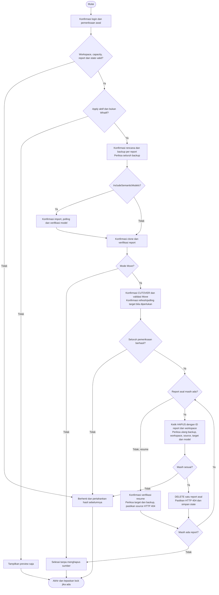

# Migrasi Power BI: Copy, Backup dan Move

[Migrate-PowerBIReports.ps1](Migrate-PowerBIReports.ps1) menyalin report antar-workspace melalui API. Semantic model terkait bisa ikut disalin dengan `-IncludeSemanticModels`.

> [!WARNING]
> **Mulai dengan satu report dan mode Copy.** Move dapat menghapus report asal dan tidak memiliki rollback otomatis. **Model serta workspace asal tidak pernah dihapus oleh script.** Jangan menutup workspace lama sebelum seluruh dependensinya diperiksa.

## Pilih kebutuhan

| Kebutuhan | Opsi | Hasil |
| --- | --- | --- |
| Cek rencana saja | Tanpa `-Apply`, atau gunakan `-WhatIf` | Login dan pemeriksaan baca saja; tidak membuat backup atau mengubah layanan |
| Salin report saja | `-Mode Copy -Apply` | Report baru tetap memakai model asal |
| Salin report + model | Tambahkan `-IncludeSemanticModels` | Model baru di destination; report terhubung ke model baru |
| Hapus report asal setelah target siap | `-Mode Move -Apply` dengan opsi model yang sama seperti Copy | Setelah konfirmasi dan pemeriksaan, hanya report asal yang dihapus |

**Backup PBIX lokal wajib sebelum perubahan.** Report/model tujuan memiliki ID baru; URL, embed dan integrasi lama perlu ditinjau. Satu model yang dipakai beberapa report hanya diimpor sekali.

## Sebelum mulai

- Gunakan **PowerShell 7+**, bukan Windows PowerShell 5.1.
- Source dan destination harus **sudah ada**, berada dalam **tenant dan capacity dedicated yang sama**. Script tidak membuat workspace atau mengubah capacity.
- Akun pengguna memiliki lisensi Pro/PPU yang sesuai, minimal Contributor di kedua workspace, serta Build pada model. Migrasi model memerlukan akses tulis model source dan izin API `Dataset.ReadWrite.All`.
- Jalur model hanya mendukung **Import refreshable di workspace source**, export IncludeModel yang didukung, serta PBIX **di bawah 1 GB**. Direct Lake, DirectQuery/nonrefreshable dan paginated/RDL tidak didukung jalur ini.
- Gunakan destination tanpa konflik nama. Siapkan ruang backup dan persetujuan pemilik report/data.
- Sepakati jendela cutover: jangan edit report/model atau refresh model source selama Copy sampai Move. Koordinasikan penjedaan jadwal source, dan catat cara mengaktifkannya kembali jika dibatalkan.

## Cara pakai yang disarankan

### 1. Siapkan PowerShell dan modul

Unduh/clone repo ini, lalu buka **PowerShell 7** pada folder yang berisi script. Pasang modul berikut sekali saja:

```powershell
Install-Module MicrosoftPowerBIMgmt.Profile -MinimumVersion 1.3.84 -Scope CurrentUser -Force
```

Jika PSGallery belum terdaftar, jalankan `Register-PSRepository -Default`. Setelah update modul, gunakan sesi PowerShell baru.

**Tidak perlu `az login`, client ID atau client secret.** Script membuka login pengguna Microsoft; pilih akun kantor yang benar dan selesaikan MFA. Jangan kirim password, token atau kode MFA ke chat/log. Script menggunakan cloud **Public**.

### 2. Isi parameter satu batch

Ganti semua placeholder. Workspace ID ada di URL `https://app.powerbi.com/groups/<WORKSPACE-ID>/...`; report ID ada setelah `/reports/`. Contoh ini membatasi **satu report dan menyertakan modelnya**.

```powershell
$migration = @{
    SourceWorkspace = "<SOURCE-WORKSPACE-ID>"
    TargetWorkspace = "<DESTINATION-WORKSPACE-ID>"
    ReportIds = @("<REPORT-ID>")
    IncludeSemanticModels = $true
    BackupDownloadType = "IncludeModel"
    BackupDirectory = "C:\PowerBI-Backups"
    StatePath = "C:\PowerBI-Migration\migration-prod.json"
}
```

- Hanya report: hapus baris `IncludeSemanticModels` **sebelum pemanggilan pertama**.
- Beberapa report: isi `ReportIds = @("<REPORT-ID-1>", "<REPORT-ID-2>")`.
- Tanpa `ReportIds`, **semua report source dipilih**. Jangan menghapusnya di tengah batch.
- Gunakan **parameter, cakupan model dan state yang sama** saat melanjutkan batch. Batch lain memerlukan state tersendiri.

### 3. Preview dahulu

```powershell
.\Migrate-PowerBIReports.ps1 @migration -Mode Copy
```

Periksa nama/ID workspace, capacity, report dan rencana tindakan. Preview belum membuktikan export/refresh akan berhasil.

Untuk memaksa simulasi walaupun `-Apply` tertulis:

```powershell
.\Migrate-PowerBIReports.ps1 @migration -Mode Move -Apply -WhatIf
```

`-WhatIf` tetap meminta konfirmasi login/pemeriksaan baca, tetapi **tidak membuat backup, state, lock, POST atau DELETE**.

### 4. Copy dan simpan backup

```powershell
.\Migrate-PowerBIReports.ps1 @migration -Mode Copy -Apply
```

Setujui hanya aktivitas yang sesuai. Script membuat backup semua report terpilih sebelum perubahan layanan, lalu mengimpor model jika dipilih dan menyalin report.

- Catat ID/URL target dari state dan lokasi `backup-manifest.json`.
- Pastikan semua backup tercatat; uji **salinan** PBIX di Power BI Desktop terbaru. Untuk migrasi penting, latih restore ke workspace Recovery terpisah.
- Copy **tidak** membuktikan credentials/gateway atau refresh model tujuan sudah siap.

### 5. Uji destination sebelum menghapus sumber

- [ ] Pada model destination, periksa **Settings**, **Gateway and cloud connections**, **Data source credentials**, dan parameter.
- [ ] Refresh target berhasil bila memakai sumber eksternal.
- [ ] Report memakai model yang benar; jika IncludeSemanticModels, **datasetId destination berbeda dari source**.
- [ ] Halaman, visual, filter, slicer, drillthrough, bookmarks dan angka sesuai.
- [ ] Uji akses dan RLS sebagai **Viewer/pengguna tujuan**, bukan Admin saja.
- [ ] Siapkan permissions, jadwal refresh, labels, sharing, subscriptions, app/audience serta perubahan URL/embed/Teams/dashboard.
- [ ] Backup/pemulihan sudah diuji dan pemilik report/data menyetujui cutover.

**Jika satu saja belum siap, tetap gunakan Copy.** Jangan edit model destination atau mengganti state untuk mengakali pemeriksaan.

### 6. Move hanya setelah target diterima

Preview penghapusan terlebih dahulu:

```powershell
.\Migrate-PowerBIReports.ps1 @migration -Mode Move
```

Setelah semua checklist terpenuhi:

```powershell
.\Migrate-PowerBIReports.ps1 @migration -Mode Move -Apply
```

Script memverifikasi target, backup dan sumber. Dengan IncludeSemanticModels, **model target dengan sumber eksternal harus selesai refresh** sebelum penghapusan pertama. Credentials tidak tersedia atau refresh gagal berarti proses berhenti, bukan melewati gate.

Move dilakukan per report, bukan satu transaksi. Pastikan hasil akhirnya `SourceDeleted`; `Verified` saja tidak berarti report asal sudah dihapus. Alihkan pengguna ke destination sesuai rencana, pantau hasilnya, dan simpan backup/state. **Audit dependensi sebelum mempertimbangkan penghapusan model atau workspace lama.**

## Cara menjawab konfirmasi

| Prompt | Teks yang harus diketik persis |
| --- | --- |
| Tahap biasa | `LANJUT` |
| Penerimaan cutover | `CUTOVER <DESTINATION-WORKSPACE-ID>` |
| Penghapusan setiap report | `HAPUS <SOURCE-REPORT-ID> DARI <SOURCE-WORKSPACE-ID>` |

Gunakan **ID aktual yang ditampilkan prompt**, bukan placeholder di atas.

- Persetujuan wajib untuk persiapan lokal, login, discovery, rencana batch, backup/verifikasi, import/polling model, clone/verifikasi report, cutover, refresh/polling dan DELETE sesuai jalur yang dijalankan.
- Konfirmasi berlaku per **aktivitas logis**; GET/polling berulang dan penulisan state internal yang terkait tidak meminta persetujuan setiap request.
- Enter, jawaban salah, pembatalan atau input tidak tersedia akan menghentikan proses. Tidak ada **Yes to All**, `-Force`, atau `-Confirm:$false` untuk melewatinya.
- Menolak polling setelah POST diterima **tidak membatalkan pekerjaan server**. Hasil tahap sebelumnya tetap ada; lanjutkan dengan state yang sama setelah ditinjau.
- Persetujuan satu DELETE tidak berlaku untuk report berikutnya atau run berikutnya.

**Setelah konfirmasi DELETE**, script memeriksa ulang backup/hash, workspace/capacity/akses, identitas source, report target/binding, dan model/sumber/refresh bila diperlukan. Jika berubah atau tidak cocok, DELETE tidak dikirim. Ini mengurangi jeda risiko, **bukan** penguncian seluruh konten atau jaminan semua perubahan visual terdeteksi.

## Backup, kegagalan dan resume

**Backup:** default ada di `Backups` di samping script; contoh di atas memakai `C:\PowerBI-Backups`. Setiap Apply membuat folder unik, PBIX dan manifest. Backup lama tidak ditimpa. Ukuran, struktur paket dan SHA256 diperiksa; file `.partial` dibersihkan jika gagal.

**IncludeModel** meminta model/data yang didukung export. **LiveConnect** hanya report dengan koneksi online, bukan model/data offline; tidak bisa dipakai bersama IncludeSemanticModels dan tidak menjadi fallback otomatis.

**State** menyimpan pemetaan ID, status, lokasi/hash backup dan ID operasi. Nilai parameter model disimpan sebagai fingerprint, bukan nilai mentah. Sebagian manifest setelah kegagalan **bukan** bukti seluruh batch selesai.

| Kondisi | Tindakan aman |
| --- | --- |
| Konfirmasi dibatalkan | Tahap yang ditolak tidak dimulai; hasil sebelumnya dipertahankan. Tinjau sebelum menjalankan ulang |
| Backup gagal/hilang/berubah | Jangan lanjut Move. Selesaikan backup dan uji pemulihan |
| Credentials/gateway atau refresh bermasalah | Konfigurasi di Power BI Service; jangan melewati pemeriksaan |
| Import/clone/refresh/DELETE timeout atau belum pasti | Periksa ID/status operasi di state dan layanan bersama admin. Jangan mengganti state atau mengulang POST secara buta |
| Konflik nama, parameter, binding atau snapshot berubah | Hentikan cutover dan tinjau perubahan; target tidak otomatis ditimpa/adopsi berdasarkan nama |
| Sebagian report asal sudah terhapus | Tidak ada rollback otomatis. Tinjau state dan pulihkan hanya item yang diperlukan dari backup yang telah diuji |

GET tertentu dapat diulang terbatas; **POST/DELETE tidak diulang otomatis**. Import/refresh yang masih berjalan dipantau melalui ID tercatat, sekitar 30 menit per pemanggilan di luar timeout HTTP. Status `ImportRequested`/`CloneRequested` atau refresh gagal/belum pasti memerlukan pemeriksaan sebelum retry.

Jangan edit status menjadi `Completed`, `Verified` atau `SourceDeleted` untuk melewati error. Jangan menjalankan batch yang sama secara bersamaan, memindahkan backup, atau menutup PowerShell saat request perubahan berjalan. Lock aktif dilepas saat proses berhenti melalui `finally`; file `.lock` tetap ada. Catatan `deletionApproval` bukan bukti DELETE sudah berhasil atau pengganti audit layanan.

## Yang tidak ikut dimigrasikan

- **Data fisik sumber:** database, file Excel/SharePoint, Lakehouse, Warehouse, dataflow dan pipeline. Referensi sumber yang sama tetap digunakan.
- **Konfigurasi layanan:** credentials/password, gateway binding, refresh schedule, permissions/sharing, keanggotaan RLS, app/audience, subscriptions, personal bookmarks, dashboard tiles, folder, endorsement dan labels tidak dimigrasikan atau diverifikasi.
- **Model/workspace asal tidak dihapus**, termasuk pada Move. Report-only tetap bergantung pada model lama; model baru juga mungkin masih bergantung pada asset lama.

Export/import dapat dibatasi tenant, label, ukuran atau jenis model. Beberapa incremental-refresh/large-model, model XMLA dan report hasil deployment/copy tertentu memiliki batasan API. Script berhenti jika jalur yang diperlukan tidak didukung; tidak menebak credentials atau berpindah metode diam-diam.

## Diagram alur aktivitas

Ringkasan; penolakan konfirmasi atau error di tahap mana pun menghentikan proses. State/pencatatan dan pemeriksaan internal termasuk dalam aktivitas yang disetujui.



## Pengujian dan batas hasilnya

Jalankan tes lokal tanpa login/akses tenant:

```powershell
pwsh -NoProfile -File .\Tests\Migrate-PowerBIReports.Tests.ps1
```

- **147 unit test** lulus: backup, Copy/Move, model, retry/resume, penolakan konfirmasi, host noninteraktif, WhatIf dan perubahan setelah persetujuan.
- Tes API nyata 25-26 November 2026 memakai sample resmi [Retail Analysis](https://learn.microsoft.com/en-us/power-bi/create-reports/sample-retail-analysis) di workspace uji pada capacity yang sama. Backup, Copy report/model dan pengulangan tanpa duplikat berhasil; 4 halaman cocok. Restore PBIX ke model terpisah juga berhasil pada tes sebelumnya.
- Versi dengan konfirmasi wajib telah diuji langsung: preview/WhatIf tanpa perubahan, Copy report + model, Copy ulang, serta **Move report-only dan resume** berhasil. Catatan persetujuan membuktikan satu DELETE disetujui untuk sample terpisah; resume hanya memverifikasi HTTP 404 tanpa persetujuan DELETE baru.
- **Move dengan model tetap terblokir** oleh `ModelRefreshFailed_CredentialsNotSpecified` pada SQL sample; report/model source dipertahankan. Respons refresh tanpa ID pelacakan dihentikan dengan aman. ID operasi tes dikorelasikan secara unik dari riwayat layanan untuk memantau kegagalan yang sama, bukan mengirim POST refresh baru. Ini bukan bukti Move dengan model sudah lulus penuh.
- Tes API memakai autentikasi harness dari sesi delegasi pengguna Azure karena unduhan modul Power BI gagal. **Atas izin pengguna, input konfirmasi otomatis hanya pada harness yang dibatasi ke ID workspace/sample uji**; script utama tidak diberi opsi bypass. Ini menguji alur dan pengaman dengan input tes, bukan penerimaan manusia untuk produksi. Login interaktif modul, UI input konsol manual, visual/RLS dan pembukaan PBIX di Desktop belum diverifikasi langsung.

## Disclaimer

Script disediakan **apa adanya (as-is)** dan digunakan dengan risiko serta tanggung jawab pengguna. Ini bukan produk resmi atau sertifikasi Microsoft; penggunaan API tidak berarti proyek didukung Microsoft. Tidak ada jaminan keberhasilan migrasi, kelengkapan backup/pemulihan, ketersediaan layanan atau kesesuaian untuk seluruh tenant.

Wajib memiliki otorisasi pemilik data, mengikuti kebijakan organisasi, dan menguji di nonproduksi. Jangan melewati kontrol akses atau pembatasan export. Import/refresh memakai resource capacity dan dapat memengaruhi workload atau biaya. API/lisensi dapat berubah.

**PBIX, manifest dan state bisa sensitif.** Gunakan lokasi dengan pembatasan akses, enkripsi disk dan retensi yang disetujui. Jangan upload backup, state, token atau credentials ke repo publik; pengabaian Git bukan pengganti pemeriksaan sebelum publish.

Sejauh diizinkan hukum yang berlaku, penulis/kontributor tidak bertanggung jawab atas kehilangan data, gangguan layanan, biaya atau kerugian akibat penggunaan script. Ini tidak mengecualikan hak/kewajiban yang tidak dapat dikecualikan secara hukum dan bukan pengganti lisensi proyek atau ketentuan layanan Microsoft.

## Referensi Microsoft Learn

- [Clone Report](https://learn.microsoft.com/en-us/rest/api/power-bi/reports/clone-report-in-group) dan [Delete Report](https://learn.microsoft.com/en-us/rest/api/power-bi/reports/delete-report-in-group).
- [Export PBIX](https://learn.microsoft.com/en-us/rest/api/power-bi/reports/export-report-in-group) dan [batas download](https://learn.microsoft.com/en-us/power-bi/create-reports/service-export-to-pbix).
- [Import PBIX/model](https://learn.microsoft.com/en-us/rest/api/power-bi/imports/post-import-in-group) dan [status import](https://learn.microsoft.com/en-us/rest/api/power-bi/imports/get-import-in-group).
- [Data sources](https://learn.microsoft.com/en-us/rest/api/power-bi/datasets/get-datasources-in-group), [parameters](https://learn.microsoft.com/en-us/rest/api/power-bi/datasets/get-parameters-in-group), [refresh](https://learn.microsoft.com/en-us/rest/api/power-bi/datasets/refresh-dataset-in-group) dan [status refresh](https://learn.microsoft.com/en-us/rest/api/power-bi/datasets/get-refresh-execution-details-in-group).
- [Login pengguna](https://learn.microsoft.com/en-us/powershell/module/microsoftpowerbimgmt.profile/connect-powerbiserviceaccount?view=powerbi-ps), [token sesi](https://learn.microsoft.com/en-us/powershell/module/microsoftpowerbimgmt.profile/get-powerbiaccesstoken?view=powerbi-ps) dan [persyaratan modul](https://learn.microsoft.com/en-us/powershell/power-bi/overview?view=powerbi-ps).
